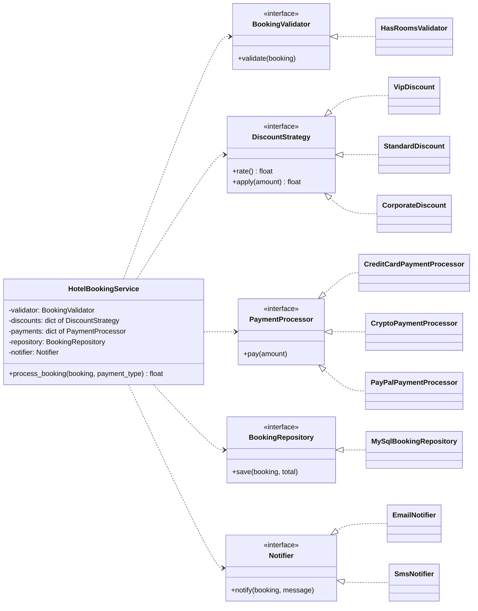

# Лабораторна робота №1. Архітектурний рефакторинг та принципи SOLID

Дисципліна: «Програмна інженерія (Software Engineering)»
Виконав: Бруско Максим, група МФ-51. **Варіант 1** — `HotelBookingProcessor` мережі готелів.

Мова: Python 3.10+. Запуск: `python main.py`. Перевірка: `python test_booking_service.py`.

## Структура

```
lab1/
├── original/hotel_booking_processor.py  # вихідний код («God Object»), номери рядків нижче — звідси
├── hotel/
│   ├── models.py                 # Booking, Room
│   ├── validation.py             # BookingValidator + HasRoomsValidator
│   ├── booking_service.py        # HotelBookingService — залежить лише від абстракцій
│   ├── discounts/                # DiscountStrategy + VipDiscount, StandardDiscount
│   ├── payments/                 # PaymentProcessor + CreditCard, Crypto
│   ├── repositories/             # BookingRepository + MySqlBookingRepository
│   ├── notifiers/                # Notifier + EmailNotifier
│   └── extensions/               # Завдання 3: CorporateDiscount, PayPal, SmsNotifier
├── main.py                       # composition root: тут обираються конкретні класи
└── test_booking_service.py
```

## Завдання 1. Аналіз та Code Review

| Принцип | Де порушено | У чому проблема |
|---|---|---|
| **S** — Single Responsibility | увесь метод `process_booking`, рядки 2–28 | Один клас валідує (4–5), рахує знижку (8–14), списує оплату (17–22), зберігає бронювання в БД (25) і надсилає Email-підтвердження (28). У нього п'ять причин змінюватися: зміна будь-якої з цих частин зачіпає один і той самий метод, а протестувати знижку окремо від оплати й бази неможливо. |
| **O** — Open/Closed | рядки 9–12 (типи гостів), 17–22 (способи оплати) | Ланцюжки `if/elif` за рядковими значеннями. Щоб додати тип гостя (Corporate) чи PayPal, треба правити вже робочий код і перетестовувати весь метод. |
| **D** — Dependency Inversion | рядки 17–22 (Stripe, Coinbase), 25 (MySQL), 28 (Email) | Бізнес-логіка напряму прив'язана до конкретних сервісів. Не можна підмінити MySQL на іншу БД чи Email на SMS, не переписавши клас; у тестах неможливо підставити заглушки. |
| **I** — Interface Segregation | клас загалом | Окремих інтерфейсів немає: увесь клас — один «товстий» контракт. Код, якому потрібен лише розрахунок знижки, залежить і від оплати, і від БД, і від пошти. |
| **L** — Liskov Substitution | — | Ієрархії класів немає, тож прямого порушення LSP немає. Але й підставити іншу реалізацію (наприклад, іншу оплату) нікуди — це наслідок порушення D, а не L. |

Додаткові проблеми, які виявив рев'ю:

- **Мовчазна помилка оплати (рядки 17–22).** Невідомий `payment_type` (наприклад, `"Cash"`) не обробляється: оплата не проходить, але бронювання все одно зберігається (25) і гість отримує лист «Your booking is confirmed» (28).
- **Невідомий тип гостя (рядок 8)** мовчки отримує знижку 0 замість помилки.
- **`raise Exception` (рядок 5)** — загальний виняток, який не можна перехопити окремо від інших помилок.

## Завдання 2. Рефакторинг

- **Знижки — патерн Strategy.** `DiscountStrategy` з методом `rate()`; реалізації `VipDiscount` (20%) і `StandardDiscount` (5%).
- **Абстракції** `PaymentProcessor`, `BookingRepository`, `Notifier`, а також `BookingValidator` (валідація теж окрема відповідальність).
- **Dependency Injection.** `HotelBookingService` отримує всі залежності через конструктор: валідатор, словники `тип гостя → стратегія` і `спосіб оплати → процесор`, репозиторій і нотифікатор.
- **`HotelBookingService` імпортує лише модулі `base`** (абстракції). Конкретні класи створюються тільки в `main.py`. Це перевіряє тест `test_booking_service_depends_only_on_abstractions`.
- Невідомий тип гостя чи оплати дає `UnsupportedOptionError` **до** списання і збереження — баг з рев'ю закрито.

## Завдання 3. Розширення без зміни наявних класів

Додано лише нові файли в `hotel/extensions/`:

| Що | Клас | Як підключається |
|---|---|---|
| Тип гостя «Corporate», знижка 30% | `CorporateDiscount(DiscountStrategy)` | новий ключ `"Corporate"` у словнику знижок |
| Оплата PayPal | `PayPalPaymentProcessor(PaymentProcessor)` | новий ключ `"PayPal"` у словнику оплат |
| SMS замість Email | `SmsNotifier(Notifier)` | передається в конструктор замість `EmailNotifier` |

Підключення показано в `main.py`, функція `build_extended_service()`. Жоден файл із Завдання 2 не змінювався: змінилася лише конфігурація в composition root, а це місце якраз і призначене для вибору конкретних реалізацій.

Результат `python main.py`:

```
=== Базова конфігурація ===
Processing credit card payment for 840.0
Saving booking 1 (total 840.0) to MySQL Database...
Sending Email to vip@example.com: Your booking is confirmed.

=== Розширена конфігурація (Завдання 3) ===
Processing PayPal payment for 735.0
Saving booking 2 (total 735.0) to MySQL Database...
Sending SMS to +380501234567: Your booking is confirmed.
```

## Завдання 4. UML-діаграма класів



`..>` — залежність (Dependency): `HotelBookingService` використовує лише інтерфейси. `<|..` — реалізація (Realization). `CorporateDiscount`, `PayPalPaymentProcessor` і `SmsNotifier` — класи із Завдання 3.

## Декларування використання ШІ

[ ] Під час виконання цієї лабораторної роботи інструменти генеративного ШІ НЕ використовувалися.

[X] Під час виконання цієї лабораторної роботи використовувалися інструменти ШІ як допоміжний засіб.

| Інструмент ШІ | Список промптів або опис задачі, делегованої ШІ |
|---|---|
| Claude (Anthropic) | 1. Надіслано умову лабораторної роботи №1 (SOLID). 2. «Зроби все, що можна, з того, що в роботі» — ШІ підготував рефакторинг, тести, README і UML-діаграму. 3. «Переробити лабу під варіант 1 (мережа готелів)» — ШІ адаптував класи, тести і звіт під `HotelBookingProcessor`. |
