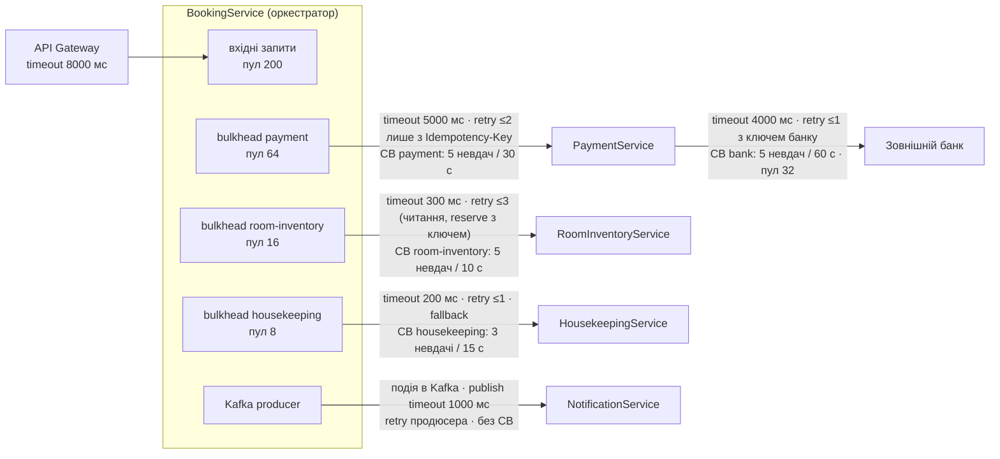
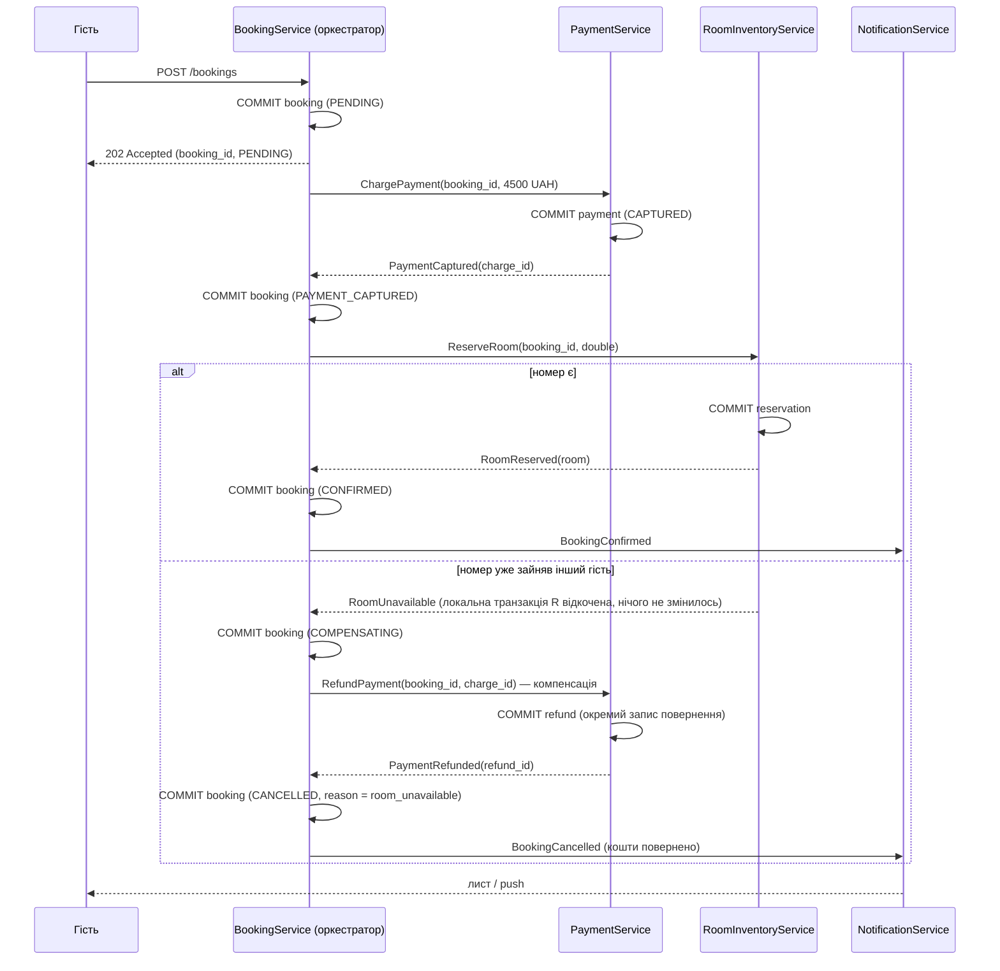

# Лабораторна робота №10. Відмовостійкість: timeout, retry, circuit breaker, bulkhead, idempotency, Saga

Дисципліна: «Програмна інженерія (Software Engineering)»
Виконав: Бруско Максим, група МФ-51. **Варіант 1** — мережа готелів: **BookingService** (оркестратор), PaymentService, RoomInventoryService, HousekeepingService, NotificationService.

Три інциденти варіанта:
1. RoomInventoryService «підвис» на 40 с (GC-пауза). У BookingService не було тайм-ауту, усі потоки повисли, і сервіс перестав відповідати навіть на запити, що не стосуються номерів.
2. Гість двічі оплатив те саме бронювання: відповідь на перший `POST /payment` загубилась, застосунок повторив запит, і PaymentService списав гроші вдруге.
3. PaymentService списав кошти, а за секунду RoomInventoryService повідомив, що останній номер уже забронював інший гість. Гроші списані, бронювання назавжди в статусі `processing`.

Код: Python 3.10+, лише стандартна бібліотека (тести — pytest).

```
pip install -r requirements.txt
pytest -v tests            # 19 тестів
python demo_retry.py       # Завдання 2: реальні випадкові затримки
python demo_saga.py        # Завдання 6: обидва сценарії Saga
python -m resilience.health   # Завдання 5: сервіс на :8080, зупинка через kill -TERM <pid>
```

```
lab10/
├── resilience/
│   ├── retry.py              # Завдання 2: retry + exponential backoff + full jitter
│   ├── circuit_breaker.py    # Завдання 3: Closed / Open / Half-Open
│   ├── bulkhead.py           # Завдання 4.1: окремі пули потоків
│   ├── idempotency.py        # Завдання 4.2: POST /payment з Idempotency-Key
│   ├── health.py             # Завдання 5: HousekeepingService, /health/live, /health/ready, graceful shutdown
│   └── saga.py               # Завдання 6: оркестратор BookingSaga (модель)
├── tests/                    # 19 тестів
├── demo_retry.py, demo_saga.py
└── results/                  # виводи демо і pytest
```

## Завдання 1. Карта відмовостійкості



### Тайм-аути — від p99 залежності

Правило: тайм-аут ≈ p99 × 2–4. Він має бути достатнім, щоб нормальні повільні відповіді проходили, але значно меншим за 40 с інциденту.

| Виклик | p99 залежності | Тайм-аут | Чому саме так |
|---|---|---|---|
| BookingService → RoomInventoryService | 80 мс | **300 мс** | швидкий внутрішній сервіс з кешем доступності (Лаба 6). ×4 від p99 дає запас на повільні запити, а при GC-паузі 40 с потік звільняється через 0,3 с |
| BookingService → HousekeepingService | 50 мс | **200 мс** | лише читання стану номера. Є fallback, тож довго чекати немає сенсу |
| BookingService → PaymentService | 1 200 мс (бо всередині банк) | **5 000 мс** | має бути **більшим** за тайм-аут Payment → Bank (4 000 мс) + накладні витрати. Інакше BookingService здасться, поки банк ще списує гроші, і стан стане невизначеним |
| PaymentService → Bank | 2 000 мс | **4 000 мс** | ×2 від p99 зовнішнього процесингу. Довше тримати потоки дорого |
| BookingService → Kafka (NotificationService) | 20 мс | **1 000 мс** на publish | сповіщення асинхронні: BookingService не чекає листа, лише підтвердження брокера |
| API Gateway → BookingService | — | **8 000 мс** | загальний бюджет запиту: 300 + 5 000 + запас на ретраї |

Тайм-аути вкладені «зсередини назовні»: кожен зовнішній більший за суму внутрішніх, які він чекає.

### Retry — де можна і де не можна

| Виклик | Retry | Пояснення |
|---|---|---|
| RoomInventory: `GET availability` | **так, до 3 спроб**, backoff + full jitter (Завдання 2) | читання ідемпотентне, повтор нічого не зламає |
| RoomInventory: `POST reserve` | **так, до 3**, з ключем `booking_id` | сервіс повертає ту саму резервацію для того самого `booking_id` (див. `saga.py`) |
| PaymentService: `POST /payment` | **так, до 2**, але **лише з тим самим `Idempotency-Key`** | без ключа повтор = подвійне списання (інцидент 2). З ключем повтор поверне збережений результат (Завдання 4) |
| PaymentService → Bank | **1 повтор**, з ключем банку | банк теж ідемпотентний за ключем |
| HousekeepingService | **1 повтор**, далі fallback «стан невідомий → номер на ручну перевірку» | стан номера не блокує продаж |
| NotificationService (Kafka) | повтори продюсера (`retries`, `enable.idempotence=true`) | доставку листів повторює сам споживач (стратегії з Лаби 2) |

**Коли retry безглуздий або небезпечний:**
- **4xx-помилки** (`422` невалідні дати, `402` картку відхилено, `409` номер зайнятий) — повтор дасть ту саму відповідь, тому вони не є `TransientError` і не повторюються (тест `test_non_transient_error_is_not_retried`);
- **неідемпотентні операції без ключа** (списання, повернення коштів) — повтор може виконати дію двічі;
- **коли circuit breaker відкритий** — повтор лише додасть навантаження на хвору залежність;
- **без jitter** — сотні клієнтів повторюють одночасно і добивають сервіс, що відновлюється (retry storm). Тому лише full jitter.

### Circuit Breaker — окремий на кожен напрямок

| Напрямок | failure_threshold | recovery_timeout | Fallback, коли відкритий |
|---|---|---|---|
| Booking → Payment | 5 послідовних | 30 с | бронювання переходить у `pending_payment`, подія чекає в Kafka (Лаба 7) |
| Booking → RoomInventory | 5 послідовних | 10 с | `503` + `Retry-After: 10` для нового бронювання; перегляд бронювань працює |
| Booking → Housekeeping | 3 послідовних | 15 с | «стан номера невідомий» → номер призначається пізніше вручну |
| Payment → Bank | 5 послідовних | 60 с | `payment.failed` з причиною `bank_unavailable`; банк зазвичай відновлюється довго |

**Чому CB для Booking → Payment не ділить стан з Booking → RoomInventory.**
- Це різні залежності, і вони падають незалежно. GC-пауза RoomInventoryService нічого не каже про здоров'я PaymentService.
- Зі спільним лічильником 5 тайм-аутів інвентарю розімкнули б і платежі. Тоді BookingService перестав би приймати оплату, хоча PaymentService і банк працюють.
- У них різна поведінка: p99 80 мс проти 1 200 мс, і відновлюється інвентар за секунди, а банк — за хвилини. Тому пороги і `recovery_timeout` різні.
- Fallback теж різний.
- Перевірено тестом `test_breakers_do_not_share_state`: розмикач `room-inventory` у стані Open, а `payment` проводить виклик.

### Bulkhead — ізольовані пули

| Пул у BookingService | Розмір | Хто ним користується |
|---|---|---|
| вхідні HTTP-запити | 200 | обробка запитів клієнтів, зокрема `GET /bookings/{id}`, що не викликає інших сервісів |
| payment | **64 — найбільший** | лише виклики PaymentService |
| room-inventory | 16 | лише виклики RoomInventoryService |
| housekeeping | 8 | лише виклики HousekeepingService |

- **Чому найбільший пул у Payment.** Це найризиковіша і найповільніша залежність: за нею зовнішній банк, якого ми не контролюємо, з p99 1,2 с. За законом Літтла, щоб тримати 50 оплат/с при 1,2 с на виклик, потрібно 50 × 1,2 = 60 одночасних викликів → пул 64.
- Для RoomInventory: 100 запитів/с × 0,08 с = 8 → пул 16 із запасом.
- Пули окремі, тому зависання банку займе максимум 64 потоки payment. Пошук номерів, перегляд бронювань і housekeeping працюватимуть.
- Інцидент 1 з таким розподілом неможливий: зависання RoomInventory вичерпає лише його 16 потоків (а тайм-аут 300 мс звільнить їх ще раніше). Пул вхідних запитів лишиться вільним.
- Коли пул заповнений, новий виклик **одразу** отримує `BulkheadFullError`, а не чекає в нескінченній черзі.

## Завдання 2. Retry з exponential backoff і full jitter

`resilience/retry.py`:

```python
def backoff_delay(attempt, base_delay, max_delay, rng):
    cap = min(base_delay * 2 ** attempt, max_delay)   # delay = min(base * 2^attempt, max_delay)
    return rng.uniform(0, cap)                         # full jitter: випадково від 0 до cap

def retry(fn, *, max_attempts=4, base_delay=0.1, max_delay=2.0, sleep=time.sleep, rng=None, on_retry=None):
    for attempt in range(max_attempts):
        try:
            return fn()
        except TransientError as error:               # лише тимчасові помилки
            if attempt == max_attempts - 1:
                raise
            delay = backoff_delay(attempt, base_delay, max_delay, rng)
            sleep(delay)
```

- Повторюється **лише** `TransientError` (тайм-аут, 503, розрив з'єднання). `ValueError` чи помилка валідації пролітає одразу.
- `sleep` і `rng` передаються ззовні, тому тести не чекають реальний час.

`python demo_retry.py` — сервіс падає 3 рази і відновлюється на 4-й спробі (`base_delay = 100 мс`, `max_delay = 1 с`). Три прогони (`results/demo_retry.txt`):

```
Прогін 1:
  спроба 1: 503 Service Unavailable (виклик 1); full jitter -> чекаємо    2.2 мс (межа 100 мс)
  спроба 2: 503 Service Unavailable (виклик 2); full jitter -> чекаємо   87.5 мс (межа 200 мс)
  спроба 3: 503 Service Unavailable (виклик 3); full jitter -> чекаємо  144.6 мс (межа 400 мс)
  спроба 4: успіх {'room_type': 'double', 'free': 3}; разом 235 мс
Прогін 2:
  спроба 1: ... чекаємо   27.0 мс (межа 100 мс)
  спроба 2: ... чекаємо  170.2 мс (межа 200 мс)
  спроба 3: ... чекаємо  285.4 мс (межа 400 мс)
  спроба 4: успіх ...; разом 483 мс
Прогін 3:
  спроба 1: ... чекаємо   93.1 мс (межа 100 мс)
  спроба 2: ... чекаємо  147.3 мс (межа 200 мс)
  спроба 3: ... чекаємо  367.5 мс (межа 400 мс)
  спроба 4: успіх ...; разом 608 мс
```

- Межа подвоюється (100 → 200 → 400 мс) — це exponential backoff.
- Реальна затримка щоразу інша і лежить у всьому діапазоні від 0 до межі — це full jitter. Повторні запити сотень клієнтів розподіляються в часі, а не б'ють у сервіс одночасно.
- Тест `test_full_jitter_is_random_and_bounded` перевіряє на 200 значеннях: усі в межах `[0, cap]`, майже всі різні, покривають і низ, і верх діапазону.

## Завдання 3. Circuit Breaker

`resilience/circuit_breaker.py` — три явні стани (`State.CLOSED`, `OPEN`, `HALF_OPEN`):

| Перехід | Умова |
|---|---|
| Closed → Open | `failure_threshold` **послідовних** невдач (успіх скидає лічильник) |
| Open | кожен `call` одразу кидає `CircuitOpenError`, функція **не викликається** |
| Open → Half-Open | автоматично, коли з моменту розмикання минуло `recovery_timeout` (перевіряється при наступному звертанні) |
| Half-Open | дозволено **рівно один** пробний виклик; паралельні виклики отримують `CircuitOpenError` |
| Half-Open → Closed | пробний виклик успішний |
| Half-Open → Open | пробний виклик невдалий; `failure_count` знову з нуля, новий відлік `recovery_timeout` |

Тест `test_all_four_transitions_and_no_calls_while_open` проганяє весь цикл з керованим годинником:
1. 3 невдачі → Open (`dep.calls == 3`).
2. 6 викликів у стані Open, зокрема на 9,9 с з 10 → усі `CircuitOpenError`, **`dep.calls` залишився 3**.
3. Рівно на 10-й секунді → Half-Open; пробний виклик невдалий → Open.
4. Ще 10 с → Half-Open; пробний виклик успішний → Closed.

Журнал переходів у тесті: `CLOSED→OPEN, OPEN→HALF_OPEN, HALF_OPEN→OPEN, OPEN→HALF_OPEN, HALF_OPEN→CLOSED`. Окремий тест `test_half_open_allows_exactly_one_trial_call` перевіряє, що другий виклик під час пробного не доходить до залежності.

## Завдання 4. Bulkhead та Idempotency

### Bulkhead

`resilience/bulkhead.py`: на кожну залежність свій `ThreadPoolExecutor` і семафор. Коли слотів немає, `BulkheadFullError` повертається одразу.

Тест `test_hung_payment_pool_does_not_block_inventory_pool`:
- 4 з 4 потоків пулу `payment` зависають (чекають подію);
- п'ятий запит у `payment` одразу отримує `BulkheadFullError`;
- **у той самий момент** запит через пул `room-inventory` виконується менш ніж за 0,5 с;
- платіжні потоки все ще висять, поки тест їх не відпустить.

### Idempotency

`resilience/idempotency.py`, `PaymentEndpoint.post_payment(idempotency_key, body)` (імітація `POST /payment`):
- без `Idempotency-Key` → `400`;
- новий ключ → списання через шлюз, результат зберігається за ключем → `201`;
- **той самий ключ і те саме тіло → збережена відповідь, шлюз не викликається**;
- той самий ключ, інше тіло → `422` (ключ повторно використано помилково);
- паралельний дубль, поки оригінал ще обробляється → `409`.

У проді сховище результатів — таблиця з `UNIQUE (idempotency_key)` і TTL 24 год.

Тести:
- `test_same_idempotency_key_charges_exactly_once` — два виклики з `key-123` → однакові відповіді, `gateway.charges == 1`;
- `test_concurrent_duplicates_charge_once` — 5 паралельних запитів з одним ключем → 1 списання, `201` + чотири `409`.

Це закриває інцидент 2: застосунок повторює `POST /payment` з тим самим ключем і отримує збережений результат першої оплати.

## Завдання 5. Health checks і graceful shutdown (HousekeepingService)

`resilience/health.py` — реальний HTTP-сервіс на `http.server`.

```python
if url.path == "/health/live":
    return self._json(200, {"status": "alive"})          # лише «процес живий»
if url.path == "/health/ready":
    if service.shutting_down:
        return self._json(503, {"status": "shutting_down"})
    if not service.db.ping():
        return self._json(503, {"status": "db_unavailable"})
    return self._json(200, {"status": "ready"})
```

- **`/health/live` (liveness)** відповідає лише на питання «чи процес живий і чи обробляє HTTP». Залежності тут **не** перевіряються. Якщо liveness падає, оркестратор (Kubernetes) **перезапускає** контейнер. Якби тут перевірялась БД, то при падінні БД перезапустились би всі екземпляри всіх сервісів, а це нічого не виправляє і створює лавину перезапусків.
- **`/health/ready` (readiness)** відповідає на питання «чи можна зараз слати сюди трафік». Перевіряє залежності, без яких сервіс не працює (пул БД), і те, що сервіс не зупиняється. Якщо readiness падає, екземпляр лише **виключається з балансувальника** без перезапуску. Коли БД повернеться, він сам стане ready.

Тест `test_live_and_ready_have_different_logic`: при недоступній БД `/health/ready` → `503 db_unavailable`, а `/health/live` → `200`.

**Graceful shutdown у чотири кроки** (`graceful_shutdown`):

1. **Отримано SIGTERM** (Kubernetes зупиняє под при деплої чи масштабуванні).
2. **Дерегістрація**: `shutting_down = True`, `/health/ready` віддає `503`. Чекаємо `deregistration_wait` (≈ період readiness-проби + оновлення балансувальника, 5–10 с). Весь цей час сервіс **продовжує обробляти** запити, які ще приходять.
3. **Очікування in-flight запитів**: чекаємо, поки лічильник активних запитів стане 0 (максимум `drain_timeout`, менший за `terminationGracePeriodSeconds`). Потім зупиняємо HTTP-сервер.
4. **Закриття ресурсів**: пул БД, продюсер Kafka, вихід із процесу.

Тест `test_graceful_shutdown_order`: повільний запит (0,6 с) уже виконується. Під час кроку 2 `/health/ready` = `503`, `/health/live` = `200`. Повільний запит завершується з `200`, і в момент відповіді БД ще **не** закрита. Журнал кроків: `1, 2, 3, 4`.

**Що буде, якщо переплутати кроки 2 і 3** (спочатку чекати in-flight, потім дерегіструватись):
- поки ми чекаємо завершення запитів, балансувальник вважає под здоровим і **продовжує слати нові запити**;
- лічильник in-flight може ніколи не дійти до нуля, і очікування закінчиться лише через тайм-аут;
- після цього ми закриваємо сервер, а балансувальник ще кілька секунд шле трафік на под, що вже не слухає порт;
- клієнти отримують `502/503` і розірвані з'єднання при **кожному** деплої.

Дерегістрація має бути першою, щоб припинити приплив нових запитів, і лише потім можна безпечно чекати, поки виконаються ті, що вже прийняті.

## Завдання 6. Saga «гість бронює номер» (orchestration)

Оркестратор — **BookingService**. Учасники — **PaymentService** і **RoomInventoryService**. У кожного своя база і свої локальні ACID-транзакції. Розподіленої транзакції (2PC) немає. Порядок кроків — як в інциденті 3: спочатку оплата, потім номер. Модель — `resilience/saga.py`, сценарії — `python demo_saga.py`, тести — `tests/test_saga.py`.



### 1. Щасливий шлях

| Крок | Хто діє | Локальний ACID COMMIT | Повідомлення |
|---|---|---|---|
| 1 | BookingService | `INSERT booking (status = PENDING)` + запис команди в outbox в одній транзакції | гостю `202 Accepted`, `booking_id` |
| 2 | BookingService → PaymentService | — | команда **`ChargePayment`** (`booking_id`, сума, `Idempotency-Key = booking_id`) |
| 3 | PaymentService | `INSERT payment (CAPTURED, charge_id)` | відповідь-подія **`PaymentCaptured`** |
| 4 | BookingService | `UPDATE booking SET status = PAYMENT_CAPTURED` | команда **`ReserveRoom`** (`booking_id`, `room_type`, дати) |
| 5 | RoomInventoryService | `INSERT reservation` + зменшення вільних номерів (з обмеженням від подвійного бронювання, Лаба 6) | подія **`RoomReserved`** |
| 6 | BookingService | `UPDATE booking SET status = CONFIRMED` | подія **`BookingConfirmed`** → NotificationService → лист гостю |

Вивід `demo_saga.py` для `bk_1`:

```
=== bk_1: CONFIRMED ===
  PENDING: booking created (BookingService COMMIT)
  PAYMENT_CAPTURED: PaymentCaptured ch_1 (PaymentService COMMIT)
  CONFIRMED: RoomReserved double-1 (RoomInventoryService COMMIT)
```

### 2. Сценарій відмови: номер зайняли після оплати

Кроки 1–4 пройшли: гроші вже **списані й закомічені** в базі PaymentService. Відкотити їх неможливо: транзакція PaymentService давно завершилась, а гроші пішли в банк. Тому потрібна компенсація — **окрема бізнес-операція повернення коштів (Refund)**, яка створює новий запис, а не стирає старий.

Компенсації йдуть у **зворотному порядку** від кроку, що впав:

| Крок | Хто діє | Що відбувається |
|---|---|---|
| 5′ | RoomInventoryService | `ReserveRoom` → **`RoomUnavailable`**. Його локальна транзакція відкотилась, тож **компенсувати в RoomInventoryService нічого не треба**: він нічого не змінив |
| 4′ | BookingService | `UPDATE booking SET status = COMPENSATING` (COMMIT) — видно, що Saga відкочується |
| 3′ | BookingService → PaymentService | команда **`RefundPayment(booking_id, charge_id, amount = 4500)`**. Це компенсація кроку 3 |
| 3″ | PaymentService | `INSERT refund (refund_id, charge_id, amount)` (COMMIT) + запит повернення в банк з ключем ідемпотентності. Запис про списання **лишається**: в історії тепер «списано» і «повернено», як у банківській виписці. Подія **`PaymentRefunded`** |
| 2′ | BookingService | `UPDATE booking SET status = CANCELLED, reason = 'room_unavailable'` (COMMIT) |
| 1′ | BookingService → NotificationService | подія **`BookingCancelled`** |

Вивід `demo_saga.py` для `bk_2`:

```
=== bk_2: CANCELLED ===
  PENDING: booking created (BookingService COMMIT)
  PAYMENT_CAPTURED: PaymentCaptured ch_2 (PaymentService COMMIT)
  COMPENSATING: RoomUnavailable (RoomInventoryService нічого не змінив)
  CANCELLED: PaymentRefunded re_1 (PaymentService COMMIT)
Сповіщення гостям:
  bk_2: на жаль, номер double уже зайнятий, кошти повернено (re_1)
```

**Як і коли гість дізнається результат.**
- Одразу після `POST /bookings` гість бачить «Бронювання прийнято, очікує підтвердження» (`PENDING`).
- Після `PaymentRefunded` (зазвичай кілька секунд) статус у застосунку стає «Скасовано: номер уже зайнятий, кошти повернено». NotificationService надсилає лист і push з номером повернення і строком зарахування коштів (до 3–5 банківських днів), і пропонує інші вільні номери чи дати.
- Через `GET /bookings/{id}` гість чи підтримка будь-коли бачать актуальний статус і історію кроків. Бронювання більше не «висне» в `processing`: у кожного стану є явний наступний крок.

**Надійність компенсації.**
- `RefundPayment` ідемпотентний за `booking_id` (`test_refund_is_idempotent`), тому оркестратор може повторювати його з backoff, доки банк недоступний.
- Стан Saga зберігається в базі BookingService. Якщо оркестратор впаде між кроками, після рестарту він продовжить з останнього закоміченого статусу (`COMPENSATING` → знову надіслати `RefundPayment`).

Якби порядок кроків можна було змінити (спочатку тимчасово утримати номер на 15 хв, потім оплата), компенсації були б дешевшими: зняти утримання номера, а не повертати гроші. Але і тоді компенсація `ReleaseRoom` потрібна, якщо впаде оплата.

### 3. Чому orchestration, а не choreography

- **Потрібен глобальний статус бронювання.** Гість, рецепція і підтримка мають бачити, на якому кроці бронювання: «оплачено, чекаємо номер», «повертаємо кошти». В оркестрації цей статус живе в одному місці — у BookingService. У хореографії його довелося б збирати з подій кількох сервісів.
- **Логіка компенсацій централізована.** Зворотний порядок і рішення «що робити при `RoomUnavailable`» описані в одному класі. У хореографії кожен сервіс мав би знати, на які чужі події реагувати компенсацією, і бізнес-процес «розмазався» б по системі.
- **Кроків небагато, але вони залежать один від одного.** Три сервіси і чіткий порядок (оплата → номер → підтвердження) — ідеальний випадок для оркестратора. Хореографія виграє, коли учасників багато і вони слабко пов'язані, а тут кожен наступний крок залежить від результату попереднього.
- **Одна команда володіє процесом.** Процес бронювання належить команді Booking (Лаба 8), тож логічно, що оркестратор живе в її сервісі і вона змінює процес без узгодження з трьома командами.
- **Налагодження й моніторинг простіші**: «застряглі» Saga видно одним запитом до таблиці бронювань (`status = COMPENSATING` довше 5 хв → алерт).
- Мінус оркестрації — BookingService стає центральною точкою, тому для нього обов'язкові всі механізми із Завдань 1–5.

## AI Usage — декларування використання ШІ

[ ] Під час виконання цієї лабораторної роботи інструменти генеративного ШІ НЕ використовувалися.

[X] Під час виконання цієї лабораторної роботи використовувалися інструменти ШІ як допоміжний засіб.

| Інструмент ШІ | Промпт / задача, делегована ШІ |
|---|---|
| Claude (Anthropic) | 1. Надіслано PDF умови лабораторної №10, варіант 1. 2. «Давай рухатися далі до 14 лаби» — ШІ склав карту відмовостійкості, реалізував retry з full jitter, circuit breaker, bulkhead, ідемпотентний endpoint, health checks з graceful shutdown і модель Saga, написав 19 тестів, запустив їх і підготував README. 3. «Зроби шпаргалку до захисту в репозиторії для кожної лаби» — ШІ підготував `cheatsheets/lab10.md`. |
