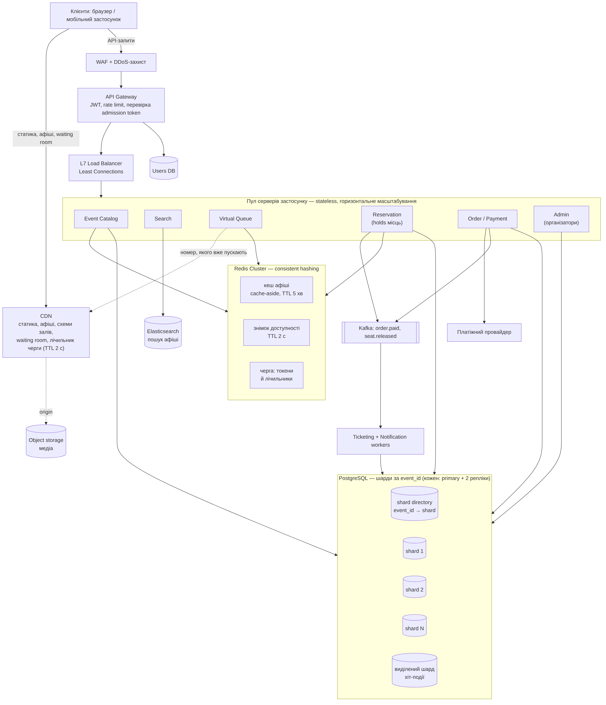

# Лабораторна робота №12. System Design: система бронювання квитків на масові заходи

Дисципліна: «Програмна інженерія (Software Engineering)»
Виконав: Бруско Максим, група МФ-51. **Варіант 1** — базовий варіант легенди: система бронювання квитків на концерти та спортивні заходи (аналог Ticketmaster / Concert.ua). Головна вимога — **жодного double-booking місця**. Вхідні дані — з легенди, без змін.

Що є в репозиторії, крім цього звіту:

```
python estimates.py                 # Завдання 2: усі розрахунки з проміжними кроками
python double_booking_demo.py       # Завдання 3: перевірка захисту від double-booking на PostgreSQL
pytest -q test_double_booking.py    # те саме як тест (пропускається, якщо PostgreSQL недоступний)
```

```
lab12/
├── estimates.py, results/estimates.txt
├── double_booking_demo.py, test_double_booking.py, results/double_booking_demo.txt
└── docs/architecture.mmd, docs/architecture.png     # Завдання 4
```

## Завдання 1. Вимоги

### Функціональні

1. **Пошук і перегляд афіші**: пошук заходів за назвою, виконавцем, містом, датою, категорією; сторінка заходу з описом, залом і цінами.
2. **Мапа місць**: інтерактивна схема залу із секторами, рядами і цінами; вільні, утримувані й продані місця позначено по-різному.
3. **Резервування (hold)**: користувач обирає до 6 місць на одне замовлення, і вони утримуються за ним **10 хвилин**, поки він оплачує. Після цього місця автоматично звільняються.
4. **Оплата**: картка / Apple Pay / Google Pay через платіжного провайдера, з підтвердженням 3-D Secure. Після оплати — електронний квиток з унікальним QR-кодом на пошту і в застосунок.
5. **Скасування й повернення**: повернення квитка за правилами організатора (наприклад, не пізніше ніж за 72 год до заходу) з поверненням коштів; місце знову стає доступним для продажу.
6. **Віртуальна черга**: на популярні заходи користувач перед стартом продажу потрапляє в чергу, бачить свою позицію й орієнтовний час очікування, і отримує доступ до вибору місць у порядку черги.
7. **Особистий кабінет**: історія покупок, активні квитки, повторне надсилання квитка.
8. **Адміністрування подій** (організатор): створення заходу, завантаження схеми залу і цін, старт і зупинка продажу, звіти продажів у реальному часі.
9. **Контроль на вході**: сканування QR-коду; кожен квиток проходить лише один раз.

### Нефункціональні

| # | Вимога | Число / поріг |
|---|---|---|
| **N1** | **Жодного double-booking**: одне місце на одному заході не може бути продане чи утримане двом людям | **0** випадків, навіть під час flash-sale і при збоях |
| N2 | Латентність перегляду афіші і сторінки заходу | p99 < **200 мс** для 99,9 % запитів |
| N3 | Латентність резервування місць (hold) | p99 < **500 мс**; при перевантаженні — швидка відмова чи черга, а не тайм-аут |
| N4 | Пропускна здатність під час flash-sale | витримати **~100 000 QPS** сплеску на вході (Завдання 2) без падіння системи для інших заходів |
| N5 | Доступність | купівля — **99,95 %** на місяць (≈ 22 хв простою); перегляд афіші — 99,99 % (через CDN) |
| N6 | Справедливість черги | користувачі, які прийшли раніше, допускаються раніше; на одного користувача — одна позиція в черзі; боти відсікаються (CAPTCHA, rate limit) |
| N7 | Збереженість даних | квитки й платежі — без втрат (RPO = 0 для підтвердженої оплати, синхронна репліка); історія покупок і скасувань — **не менше 3 років** (податкова звітність, спори) |
| N8 | Безпека | PCI DSS: дані карток лише в платіжного провайдера; QR-коди підписані (неможливо підробити) |

**Найважливіша для архітектури — N1 (жодного double-booking).** Від неї залежить усе інше:
- операція резервування мусить бути **CP** (Завдання 5);
- дані місць одного заходу мають жити в одному шарді, щоб резервування кількох місць було однією ACID-транзакцією (шардування за `event_id`);
- кеш і репліки використовуються лише для показу, а рішення «місце вільне» приймається тільки на primary;
- обмеження N4 вирішується чергою перед резервуванням, а не послабленням консистентності.

Помилку в латентності користувач пробачить, а два квитки на одне місце — це конфлікт біля входу, повернення грошей і репутаційний удар.

## Завдання 2. Навантажувальні розрахунки

Повний вивід — `results/estimates.txt` (рахує `estimates.py`).

**1. Середній QPS:**

```
запитів на день = 1 000 000 DAU × 20 = 20 000 000
середній QPS    = 20 000 000 / 86 400 с ≈ 231 QPS  (≈ 250 QPS для округлення)
```

**2. Піковий QPS звичайного дня — коефіцієнт ×5:**

```
пік = 231 × 5 ≈ 1 157 QPS  (≈ 1 200 QPS)
```

Чому ×5:
- аудиторія — в одному-двох часових поясах, і основна активність припадає на вечір (19:00–23:00). Це ~4 години, на які приходить більша частина денного трафіку;
- старти продажів звичайних (не хітових) заходів анонсуються на певний час, наприклад 10:00, і створюють короткі сплески;
- типовий коефіцієнт для споживчих сервісів — 2–5. Я беру верхню межу, бо квитковий сервіс подієвий.

**3. Flash-sale найпопулярнішого заходу:**

```
запитів           = 1 000 000 людей × 2 запити = 2 000 000
середній QPS      = 2 000 000 / 60 с ≈ 33 333 QPS
сплеск (половина запитів у перші 10 с) = 1 000 000 / 10 с = 100 000 QPS
у порівнянні зі звичайним піком: 33 333 / 1 157 ≈ ×29, сплеск 100 000 / 1 157 ≈ ×86
на одне місце: 1 000 000 / 50 000 = 20 бажаючих
```

Тобто flash-sale — це не «трохи більше трафіку», а навантаження в **30–90 разів** вище за звичайний пік, і на кожне місце претендують 20 людей. Тримати 30–90 запасних потужностей цілий рік економічно безглуздо. Звідси віртуальна черга і CDN у Завданні 3.

**4. Транзакційні дані за 5 років:**

```
квитків        = 50 000 заходів × 1 000 місць × 5 років = 250 000 000
замовлень      = 250 000 000 / 2 (у середньому 2 квитки)  = 125 000 000
рядків місць   = 250 000 000 × 2 (місткість ≈ 2× проданих) = 500 000 000

квитки:     250 млн × 500 Б  = 125 ГБ   (id, event, seat, ціна, статус, QR-підпис, час)
замовлення: 125 млн × 1 КБ   = 125 ГБ   (покупець, платіж, історія статусів і скасувань)
місця:      500 млн × 200 Б  = 100 ГБ   (event_id, seat_id, сектор, ряд, ціна, статус, версія)
сирі дані:  125 + 125 + 100  = 350 ГБ
+ індекси (+50 %):  350 × 1,5 = 525 ГБ
× 3 копії (primary + 2 репліки): 525 × 3 ≈ 1 575 ГБ ≈ 1,6 ТБ
```

Висновок: за обсягом дані вмістилися б навіть на один сервер. Шардування в Завданні 3 потрібне не через обсяг, а через **запис під час flash-sale** і ізоляцію хітових заходів.

**5. Медіа за рік:**

```
на захід: афіша в 3 розмірах ≈ 1 МБ + 5 фото × 0,5 МБ = 3,5 МБ
афіші й фото:  50 000 × 3,5 МБ = 175 ГБ
схеми залів:   5 000 залів × 1 МБ SVG = 5 ГБ  (схеми повторно використовуються)
разом:         175 + 5 = 180 ГБ на рік
```

Зберігається в object storage (S3), видається через CDN.

**6. Bandwidth:**

```
звичайний середній: 231 QPS × 20 КБ × 8 біт ≈ 37 Мбіт/с
звичайний пік:      1 157 QPS × 20 КБ × 8   ≈ 185 Мбіт/с

flash-sale без черги (сторінка + мапа місць ≈ 100 КБ):
                    33 333 × 100 КБ × 8 ≈ 26,7 Гбіт/с
flash-sale з чергою і CDN:
  CDN (waiting room ≈ 50 КБ, з кешу edge-вузлів): 33 333 × 50 КБ × 8 ≈ 13,3 Гбіт/с — розподілено по edge-вузлах CDN
  origin (API «стати в чергу» ≈ 1 КБ):           33 333 × 1 КБ × 8  ≈ 267 Мбіт/с
```

20 КБ — середня відповідь API разом із HTML (зображення йдуть через CDN). Без черги й CDN дата-центр мав би прийняти ~27 Гбіт/с. З ними origin бачить ~0,3 Гбіт/с — величину того ж порядку, що звичайний пік.

## Завдання 3. Вибір компонентів

**Балансування навантаження — різні алгоритми для різних шарів.**
- **Сервери застосунку — Least Connections.** Запити дуже нерівні: перегляд афіші — 20 мс, резервування з транзакцією в БД — сотні мс, оплата з викликом провайдера — секунди. Round Robin рівномірно роздає запити, але не тривалість роботи, і повільні запити накопичуються на окремих вузлах. Least Connections відправляє новий запит туди, де менше активних.
- **Redis-кластер і сервіс черги — Consistent Hashing за `event_id`.** Стан черги і знімок доступності одного заходу мають бути на одному вузлі. При додаванні вузла переміщується лише ~1/N ключів, а не весь кеш.
- **CDN — гео-балансування** (найближчий edge-вузол за DNS / anycast).

**Sticky sessions — не потрібні.** Сервери застосунку stateless: при 33 000 QPS flash-sale автоскейлер додає й прибирає вузли, і прив'язка користувача до вузла заважала б цьому і перевантажувала б окремі вузли. Стан живе поза серверами:
- **автентифікація** — у JWT (access token 15 хв), який перевіряє Gateway;
- **позиція в черзі й admission token** — підписаний токен у клієнта + лічильники в Redis;
- **утримання місць (hold) — у базі** (`seats.status = 'held'`, `holder`, `hold_expires`), бо це частина інваріанту N1. Будь-який вузол бачить той самий hold.

**Масштабування:**
- **(а) шар застосунку — горизонтальне.** Звичайний пік ~1 200 QPS — це 4–6 інстансів (≈ 300 QPS на інстанс із запасом). На flash-sale з чергою origin отримує до ~33 000 легких запитів/с, тож автоскейлінг до 40–60 інстансів. Сервери stateless, тому додати вузол = запустити ще один контейнер. Перед анонсованим продажем масштабуємо заздалегідь (pre-warming), не чекаючи метрик.
- **(б) шар даних — спочатку вертикальне + репліки, потім горизонтальне шардування.**
  - 1,6 ТБ за 5 років — це обсяг одного потужного сервера. Тому читання (афіша, історія покупок) йде на репліки, а primary нарощується вертикально.
  - Але записи під час flash-sale (резервування 50 000 місць за кілька хвилин) не масштабуються репліками. Тому місця й замовлення шардуються горизонтально (див. нижче), щоб хітовий захід не зупиняв продаж інших.

**Шардування бази місць — за `event_id`.**
- Майже всі запити йдуть у межах одного заходу: мапа місць, резервування 2–6 місць, оплата замовлення. З ключем `event_id` резервування кількох місць — це **одна локальна ACID-транзакція на одному шарді**, без розподілених транзакцій. Це прямо служить N1.
- `user_id` як ключ не підходить: конкуренція йде між **різними** користувачами за те саме місце, і вони опинились би на різних шардах.
- `seat_id` теж не підходить: місця одного замовлення розкидались би по шардах.
- **Мінус** — «гарячий» шард: увесь flash-sale хітового заходу йде в один шард. Тому розподіл не за `hash(event_id)`, а через **shard directory** (`event_id → shard`): хітовий захід заздалегідь переносимо на **виділений шард**. Навантаження на нього обмежує черга: 50 000 місць за ~10 хв — це ~100 резервувань/с і кілька сотень запитів/с з повторами. Один PostgreSQL це витримує.

**Кешування:**

| Що | Де | TTL | Патерн |
|---|---|---|---|
| Статика, афіші, фото, SVG-схеми залів | CDN | 1 доба, версійні URL (нова версія = новий URL) | pull-through CDN |
| Список заходів, сторінка заходу, ціни | Redis | 5 хв + активна інвалідація при зміні в адмінці | **Cache-aside** (як у Лабі 6) |
| Знімок доступності місць для мапи (стиснутий бітмап 50 000 місць ≈ 6 КБ) | Redis | 2 с | **Write-through** з боку Reservation service: після кожного hold / release оновлюється біт |
| Лічильник «зараз пускаємо номер N» для черги | CDN (JSON) + Redis | 2 с | публікація сервісом черги |
| Сесії / admission tokens | Redis | до 10 хв | — |

Кеш доступності **ніколи не використовується для рішення** «можна резервувати». Це лише картинка для мапи, а рішення приймає умовний `UPDATE` на primary. Через 2-секундну застарілість користувач іноді клікне на щойно зайняте місце і побачить «місце вже зайняте, оберіть інше».

**Захист від double-booking — обидва механізми, на різних кроках.**

1. **Атомарний умовний UPDATE (optimistic locking) при утриманні місця:**

   ```sql
   UPDATE seats
      SET status = 'held', holder = :user, hold_expires = now() + interval '10 minutes',
          version = version + 1
    WHERE event_id = :event AND seat_id = ANY(:seats) AND status = 'available'
   RETURNING seat_id;
   -- якщо повернулось менше рядків, ніж обрано місць -> ROLLBACK, «частину місць уже зайнято»
   ```

   - Перевірка і запис — одна операція в базі, тому гонки «прочитав вільне → записав» немає.
   - Довгих блокувань немає: невдаха одразу отримує 0 рядків.
   - Прострочені hold звільняє фоновий job (`status = 'held' AND hold_expires < now()` → `available`) і публікує `seat.released`.
   - **Останній рубіж:** `UNIQUE (event_id, seat_id)` у таблиці `tickets` — навіть баг у коді не створить два квитки на одне місце.

2. **Idempotency key при оплаті** (`POST /orders/{id}/pay` з `Idempotency-Key`, як у Лабах 7 і 10): повторний запит через погану мережу не спише гроші двічі і не створить другий квиток.

   Перевірено на PostgreSQL 16 (`python double_booking_demo.py`, 80 паралельних покупців на одне місце):

   ```
   Наївний check-then-act: 80 покупців -> переможців: 6 (double-booking!)
   Умовний UPDATE ... WHERE status = 'available': 80 покупців -> переможців: 1
   Оплата двічі з тим самим Idempotency-Key: tk_d717c92b == tk_d717c92b -> квитків на місце: 1
   Спроба вставити другий квиток на те саме місце в обхід логіки: UNIQUE спрацював (UniqueViolation)
   ```

   Кількість «переможців» у наївному варіанті змінюється від запуску до запуску, але майже завжди більша за 1. В умовному UPDATE — завжди рівно 1.

**Віртуальна черга — так, обов'язкова.**
- 1 000 000 людей на 50 000 місць (20 на місце) і сплеск 100 000 QPS — у 86 разів більше за звичайний пік. Пустити всіх одразу до резервування — означає покласти базу хітового заходу і разом з нею продаж інших заходів.
- **Як працює:**
  - До старту продажу всі отримують статичну сторінку waiting room з CDN.
  - У момент старту кожен робить один запит `POST /queue/{event_id}/join` і отримує номер у черзі. Номер видає атомарний `INCR` у Redis (порядок приходу), а після нього підписаний токен `{event_id, user_id, номер}`. Одна позиція на акаунт; CAPTCHA і rate limit проти ботів.
  - Клієнт не питає сервер «яка моя позиція». Він раз на 5–10 с (з jitter) читає з **CDN** JSON-файл `«зараз пускаємо до номера N»` (TTL 2 с). 1 млн клієнтів б'ють у CDN, а не в origin.
  - Сервіс черги збільшує N з постійною швидкістю **допуску** (наприклад, 2 000 користувачів/хв), підібраною під пропускну здатність шарду заходу і кількість ще не проданих місць. Коли місця закінчились — черга закривається, решта отримують «квитки розпродано».
  - Допущений користувач отримує **admission token** (JWT на 10 хв) і лише з ним API Gateway пропускає запити до мапи місць і резервування.
- Так origin бачить постійний, керований потік, а не сплеск, а справедливість (N6) забезпечує порядок номерів.

## Завдання 4. Архітектурна схема



Джерело схеми — `docs/architecture.mmd` (Mermaid). PNG згенеровано з нього через `mmdc`.

Потоки запитів:
1. **Статика, афіші, waiting room, лічильник черги** → CDN (origin — object storage). Це левова частка трафіку flash-sale.
2. **API-запити** → WAF / DDoS-захист → **API Gateway** (перевірка JWT, rate limit, admission token для резервування) → **L7 Load Balancer** (Least Connections) → пул stateless-сервісів.
3. **Event Catalog** читає афішу з Redis (cache-aside) і з реплік PostgreSQL. **Search** — з Elasticsearch.
4. **Virtual Queue** зберігає номери й токени в Redis і публікує «кого вже пускаємо» в CDN.
5. **Reservation** через shard directory знаходить шард заходу, робить умовний UPDATE на primary, оновлює знімок доступності в Redis і публікує `seat.held` / `seat.released` у Kafka.
6. **Order / Payment** викликає платіжного провайдера з Idempotency-Key, записує замовлення в той самий шард заходу і публікує `order.paid` у Kafka.
7. **Ticketing + Notification workers** читають Kafka: генерують підписані QR-квитки, надсилають листи, оновлюють аналітику.
8. **Admin** (організатори) пише події й схеми залів у БД і медіа в object storage.

## Завдання 5. Обґрунтування через CAP

| Операція | Позиція | Ціна помилки | Що відбувається при розриві мережі |
|---|---|---|---|
| **Резервування місця (hold)** | **CP** | double-booking: двоє людей приходять на одне місце, конфлікт на вході, повернення грошей, скандал. Порушення головної вимоги N1 | шард заходу приймає запис лише на primary. Якщо primary недоступний чи без кворуму, резервування відповідає `503 «спробуйте за хвилину»`. Краще втратити кілька секунд продажу, ніж продати місце двічі |
| **Оплата замовлення** | **CP** | подвійне списання або «оплачено, але квитка немає». Гроші й юридичні спори | запис замовлення і квитка — одна транзакція на primary з синхронною реплікою (RPO = 0). При розриві оплата повертає помилку, а повтор безпечний завдяки Idempotency-Key |
| **Перегляд афіші, сторінки заходу** | **AP** | користувач кілька хвилин бачить стару ціну чи опис. Остаточна ціна все одно береться з primary в момент резервування | CDN і Redis віддають кешовану версію навіть без зв'язку з базою. Доступність тут важливіша: недоступна афіша = втрачений продаж |
| **Мапа доступності місць** | **AP** | місце показане вільним, хоча його щойно зайняли. Користувач отримає «місце вже зайняте» при резервуванні — неприємно, але безпечно | показуємо знімок віком до 2 с з Redis. Рішення все одно приймає CP-операція hold |
| **Історія покупок** | **AP** (з read-your-writes) | квиток, куплений щойно, з'явиться в історії на кілька секунд пізніше | читання з репліки. Щоб людина не злякалась, протягом 1 хв після своєї покупки її запити йдуть на primary |
| **Позиція у віртуальній черзі** | **AP** | позиція чи «очікуваний час» трохи неточні | клієнт читає лічильник із CDN. Справедливість забезпечує номер у підписаному токені, виданий один раз |
| **Списання з подарункового сертифіката** | **CP** | сертифікат витрачено двічі — пряма втрата грошей | умовний UPDATE балансу (`WHERE balance >= :amount`) на primary. **Перегляд** балансу в кабінеті — AP з репліки |

**Чому відповідь не може бути однією для всієї системи.**
- CAP — це вибір для **конкретних даних і конкретної операції** при розриві мережі, а ціна помилки в різних операціях відрізняється на порядки.
- Якби вся система була **CP**, то при будь-якому мережевому збої перестала б відкриватися навіть афіша, і 1 млн людей на flash-sale бачили б помилки там, де застаріла на хвилину сторінка нікому не шкодить. Це вбило б доступність (N5) і CDN-кешування.
- Якби вся система була **AP**, то два вузли під час розриву могли б продати те саме місце двом людям, і головна вимога N1 була б порушена.
- Тому система — **CP в ядрі** (місця, замовлення, гроші: невеликий обсяг записів, які обмежує черга) і **AP на периферії** (афіша, мапа, історія, черга: величезний обсяг читань). Межа між ними — момент, коли приймається незворотне рішення про місце чи гроші: усе до нього може бути застарілим, а саме воно — ні.

## AI Usage — декларування використання ШІ

[ ] Під час виконання цієї лабораторної роботи інструменти генеративного ШІ НЕ використовувалися.

[X] Під час виконання цієї лабораторної роботи використовувалися інструменти ШІ як допоміжний засіб.

| Інструмент ШІ | Промпт / задача, делегована ШІ |
|---|---|
| Claude (Anthropic) | 1. Надіслано PDF умови лабораторної №12, варіант 1. 2. «Давай рухатися далі до 14 лаби» — ШІ сформулював вимоги, написав скрипт розрахунків, обґрунтував компоненти, намалював архітектурну схему, перевірив захист від double-booking на PostgreSQL і підготував README. 3. «Зроби шпаргалку до захисту в репозиторії для кожної лаби» — ШІ підготував `cheatsheets/lab12.md`. |
