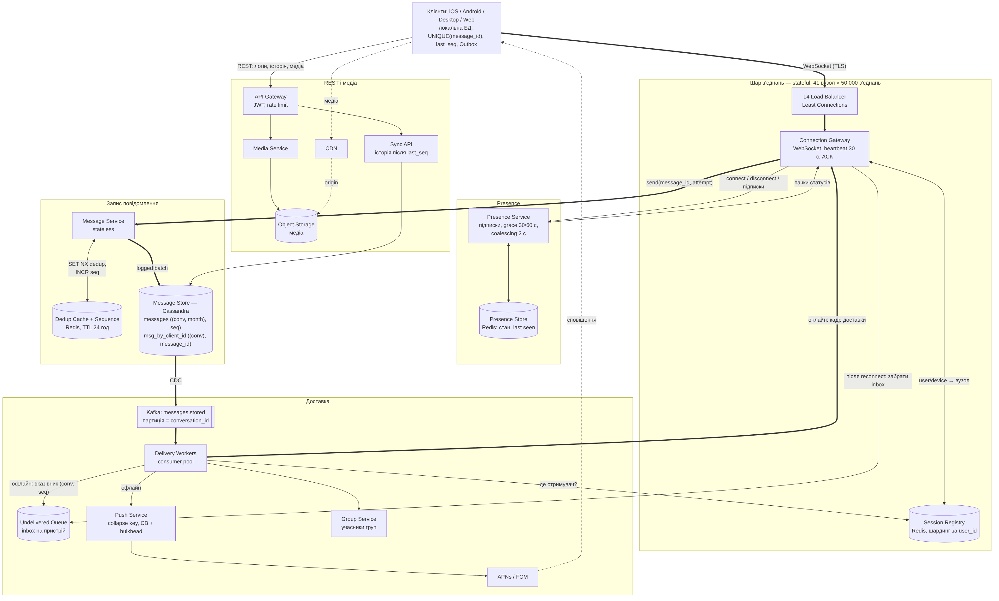

# Лабораторна робота №13. System Design: real-time месенджер

Дисципліна: «Програмна інженерія (Software Engineering)»
Виконав: Бруско Максим, група МФ-51.

**Варіант 1, обрано систему A — real-time месенджер** (аналог WhatsApp / Telegram): текстові повідомлення 1-на-1 і в групах, статус «онлайн» / «був у мережі», доставка при офлайні отримувача.
Вхідні дані базові: 50 000 000 зареєстрованих користувачів, 5 000 000 DAU, у середньому 40 повідомлень на користувача на день.

Документ — архітектурний. Код у репозиторії лише перевіряє два ключові механізми із Завдання 4 на моделях, а цифри Завдання 2 рахує скрипт:

```
python estimates.py            # Завдання 2: усі розрахунки з проміжними кроками
python simulate_dedup.py       # Завдання 4(а): дедуплікація в мережі, що губить запити й ACK
python simulate_presence.py    # Завдання 4(б): fan-out presence наївно vs оптимізовано
pytest -q tests                # 12 тестів
```

```
lab13/
├── estimates.py, results/estimates.txt
├── messenger/dedup.py         # MessageId, Message Service, Message Store, Device (outbox + локальна БД)
├── messenger/presence.py      # NaivePresence і Presence Service
├── simulate_dedup.py, simulate_presence.py, results/*_simulation.txt
├── tests/                     # test_dedup.py, test_presence.py
└── docs/architecture.mmd, docs/architecture.png
```

Потрібен лише Python 3.10+ і pytest.

## Завдання 1. Вимоги

### Функціональні

1. **Повідомлення 1-на-1.** Текст до 4 096 символів доставляється в реальному часі, якщо отримувач онлайн.
2. **Групові чати до 1 000 учасників.** Створення групи, додавання й видалення учасників, адміністратори.
3. **Статуси доставки.**
   - «Надіслано» (одна галочка) — повідомлення збережене на сервері.
   - «Доставлено» (дві) — воно на пристрої отримувача.
   - «Прочитано» — його відкрили.
4. **Доставка при офлайні отримувача.** Повідомлення зберігається, отримувач отримує push-сповіщення. Після підключення він отримує всі пропущені повідомлення у правильному порядку.
5. **Presence.**
   - «онлайн» / «був у мережі о 21:43» для контакту у відкритому чаті та в списку чатів;
   - налаштування приватності: показувати всім, лише контактам або нікому.
6. **Кілька пристроїв і історія.** До 5 пристроїв на акаунт (телефон, desktop, web). Новий пристрій отримує історію за 2 роки.
7. **Медіа-вкладення.** Фото й файли до 100 МБ. Вони завантажуються окремим сервісом, а в повідомленні лише посилання.

### Нефункціональні

| # | Вимога | Число / поріг |
|---|---|---|
| **N1** | **Надійність доставки**: жодне повідомлення, яке отримало «надіслано», не губиться; користувач не бачить дублів; порядок у розмові однаковий на всіх пристроях | **0** втрачених, **0** видимих дублів, порядок = `server_seq` |
| N2 | Латентність доставки онлайн-отримувачу (в межах регіону) | p50 < **100 мс**, p99 < **500 мс**; ACK «надіслано» — p99 < **300 мс** |
| N3 | Масштаб | **1,35 млн** одночасних WebSocket-з'єднань у пік; **7 000** повідомлень/с у пік і **23 000**/с у Новий рік без деградації (Завдання 2) |
| N4 | Доступність | надсилання й отримання — **99,99 %** на місяць (≈ 4,3 хв простою). Presence може деградувати («був нещодавно») і не впливає на повідомлення |
| N5 | Свіжість presence | «онлайн» з'являється у глядача за ≤ **3 с**; «офлайн» — за ≤ **32 с** після виходу у фон і ≤ **62 с** після обриву з'єднання; похибка last seen ≤ **1 хв** |
| N6 | Збереженість | історія **2 роки**, 3 репліки, RPO = 0 для повідомлень з ACK (запис кворумом) |
| N7 | Безпека | TLS 1.3 у транзиті, шифрування на диску. Наскрізне (E2E) шифрування — поза межами цієї роботи |

**Найважливіша вимога — N1 (надійна доставка без втрат і дублів, у правильному порядку).**

Затримку в пів секунди користувач не помітить. А загублене «я в лікарні» чи повідомлення, що прийшло двічі або не в тому порядку, руйнує довіру до месенджера. N1 визначає архітектуру так:
- **Спочатку запис, потім ACK.** «Одна галочка» з'являється лише після запису кворумом у **Message Store**. Тому Message Store стоїть на синхронному шляху надсилання.
- **At-least-once усюди + дедуплікація.** Мережа мобільних клієнтів ненадійна, тому клієнт повторює надсилання, а сервер повторює доставку після reconnect. «Рівно один раз» досягається лише дедуплікацією за `message_id` на трьох рівнях (Завдання 4а).
- **Порядок через `server_seq`.** Кожна розмова має свій монотонний номер. Kafka партиціонується за `conversation_id`, Message Store сортує розмову за `seq`, клієнт тримає курсор `last_seq` і за пропуском робить sync.
- **Офлайн-отримувач.** Для нього є **Undelivered Queue**, **Push Service** і sync за курсором.
- **Доставку запускає CDC з Message Store, а не код сервісу** (проблема dual write з Лаби 7). Падіння між записом і публікацією в Kafka не губить доставку.

N2 вимагає постійних WebSocket-з'єднань і stateful **Connection Gateway**. Але виконувати її має сенс лише поверх N1: швидко доставлене, а потім загублене повідомлення гірше за повільне.

## Завдання 2. Оцінка навантаження

Повний вивід — [`results/estimates.txt`](results/estimates.txt) (рахує `estimates.py`).

**Припущення.**

| Параметр | Значення | Чому |
|---|---|---|
| Пік вечірньої години | × 3 до середнього | активність у месенджері розподілена по добі рівніше, ніж у квитковому сервісі; вечірня година ≈ 3× середньої |
| Новий рік, 00:00 | × 10 до середнього | класичний сплеск привітань |
| Розмови | 70 % — 1-на-1, 30 % — групи по 10 учасників | групових повідомлень менше, але кожне йде 9 отримувачам |
| Час з відкритим з'єднанням | 2,5 год на добу | телефон у фокусі + desktop/web, які тримають з'єднання годинами |
| Пристроїв на користувача | 1,3 | більшість — лише телефон |
| Розмір повідомлення | 200 Б | 100 Б тексту (≈ 50 кириличних символів у UTF-8) + 100 Б метаданих: `message_id` 16, `conversation_id` 8, `server_seq` 8, відправник 8, час 8, тип і прапорці, накладні витрати рядка |
| Контакти | 150, з них 20 % онлайн одночасно | ≈ частка DAU, онлайн у пік (див. нижче) |

**1. QPS повідомлень.**

```
повідомлень на добу       5 000 000 × 40           = 200 000 000
середній QPS              200 000 000 / 86 400     = 2 315 msg/s
пік вечірньої години      2 315 × 3                = 6 944 msg/s
сплеск у Новий рік        2 315 × 10               = 23 148 msg/s
доставок на повідомлення  0.7 × 1 + 0.3 × 9        = 3.4
доставок/с у пік          6 944 × 3.4              = 23 611 deliveries/s
доставок/с у Новий рік    23 148 × 3.4             = 78 704 deliveries/s
квитанції delivered+read  23 611 × 2               = 47 222 events/s у пік
```

Запис у Message Store — це QPS надсилання (до 23 000/с). Доставок і квитанцій у кілька разів більше, і вони йдуть через **Connection Gateway**, а не в базу.

**2. Одночасні WebSocket-з'єднання.**

```
у середньому онлайн       5 000 000 × 2.5 / 24     = 520 833 користувачів
у пік                     520 833 × 2              = 1 041 667 (20.8 % DAU)
з'єднань                  1 041 667 × 1.3          = 1 354 167
вузлів Connection Gateway 1 354 167 / 50 000       = 27.1 -> × 1.5 на втрату зони = 41
пам'ять                   1 354 167 × 30 КБ        = 40.6 ГБ на весь кластер (1.5 ГБ на вузол)
heartbeat                 1 354 167 / 30 с         = 45 139 ping/s
```

- **Чому 50 000 з'єднань на вузол, хоча технічно можна і 500 000?** Пам'ять тут не обмеження (1,5 ГБ на вузол). Але менший вузол — менший «радіус вибуху»: його падіння дає 50 000 перепідключень, а не пів мільйона (Завдання 5, вузьке місце 1).
- **Heartbeat-пінгів (45 000/с) більше, ніж повідомлень.** Тому їх обробляє сам Connection Gateway. У Presence Service ідуть лише події connect і disconnect.

**3. Сховище повідомлень за 2 роки.**

```
повідомлень               200 000 000 × 365 × 2    = 146 000 000 000
сирий обсяг               146 млрд × 200 Б         = 29.2 ТБ
× 3 репліки (RF = 3)      29.2 × 3                 = 87.6 ТБ
+ 30 % під compaction     87.6 × 1.3               = 114 ТБ -> 29 вузлів по 4 ТБ
медіа (окремо)            146 млрд × 0.1 × 300 КБ  = 4.4 ПБ в object storage
```

Медіа на три порядки більші за текст. Тому вони живуть в **Object Storage** за **CDN**, а Message Store зберігає лише посилання.

**4. Fan-out presence-сповіщень для типового користувача.**

```
онлайн-контактів                       150 × 0.2         = 30
змін online/offline на добу            25 відкриттів × 2 = 50
наївно: подій на користувача на добу   50 × 30           = 1 500
наївно: на всіх                        5 000 000 × 1 500 = 7.5 млрд/добу = 86 806 events/s
                                       86 806 / 2 315    = у 37.5 раза більше, ніж повідомлень
з підпискою + grace 30 с               16 переходів × 3 глядачі = 48 на користувача
оптимізовано                           5 000 000 × 48 / 86 400 = 2 778 events/s (у 31 раз менше)
падіння 1 вузла Gateway, наївно        50 000 × 30       = 1 500 000 подій offline одночасно
```

Наївний presence генерує в 37 разів більше подій, ніж самі повідомлення. Тому обмеження fan-out — ключовий компонент (Завдання 4б).

Модель на 5 000 користувачах ([`results/presence_simulation.txt`](results/presence_simulation.txt)) підтверджує порядок: у вечірню годину наївно **721** подія на користувача, оптимізовано **13** (у **54** рази менше).

## Завдання 3. Архітектурна схема



Джерело — [`docs/architecture.mmd`](docs/architecture.mmd) (Mermaid), PNG згенеровано через `mmdc`. Назви компонентів у схемі, у тексті й у коді однакові.

**Потоки запитів.**

1. **Надсилання.** Клієнт (Outbox) → **L4 Load Balancer** (Least Connections) → **Connection Gateway** → **Message Service**. Далі Message Service:
   - перевіряє дубль і бере `seq` у **Dedup Cache + Sequence** (Redis);
   - пише в **Message Store** (Cassandra) одним logged batch;
   - повертає ACK «надіслано» через Connection Gateway.
2. **Доставка.**
   - Message Store → **CDC** → **Kafka `messages.stored`** (партиція = `conversation_id`) → **Delivery Workers**.
   - Workers беруть учасників з **Group Service** і місцезнаходження отримувача з **Session Registry**.
   - Онлайн-отримувачу кадр іде через його вузол **Connection Gateway**.
   - Офлайн-отримувачу пишеться вказівник `(conversation_id, seq)` в **Undelivered Queue**, а **Push Service** надсилає сповіщення через **APNs / FCM**.
3. **Після reconnect.**
   - Connection Gateway реєструє з'єднання в Session Registry і забирає inbox з Undelivered Queue.
   - Якщо клієнт бачить пропуск у `server_seq`, він питає **Sync API** «усе після `last_seq`». Sync API читає Message Store.
4. **Presence.**
   - Connection Gateway повідомляє **Presence Service** про connect / disconnect і про підписки (чиї статуси зараз на екрані).
   - Presence Service тримає стан у **Presence Store** (Redis) і відправляє пачки статусів глядачам через Connection Gateway.
5. **REST і медіа.** **API Gateway** (JWT, rate limit) → Sync API і **Media Service** → **Object Storage**. Клієнти завантажують медіа через **CDN**.

**Чому саме такі компоненти.**
- **L4, а не L7 Load Balancer, з Least Connections.** З'єднання живуть годинами. Після хвилі перепідключень Round Robin лишив би старі вузли переповненими, а Least Connections вирівнює.
- **Message Store — Cassandra.**
  - Навантаження — переважно запис: до 23 000 повідомлень/с × 3 репліки.
  - Доступ завжди «розмова, відсортована за seq», що лягає на wide-column: `PRIMARY KEY ((conversation_id, month), server_seq)`.
  - 114 ТБ масштабуються додаванням вузлів (Лаба 6: вибір NoSQL під патерн доступу).
  - Місячний bucket у ключі партиції не дає партиції активного чату рости безмежно.
- **Kafka з партицією за `conversation_id`.** Порядок усередині розмови зберігається, а Delivery Workers масштабуються кількістю партицій (Лаба 7).
- **Undelivered Queue** зберігає не тексти, а вказівники: `PRIMARY KEY ((device_id), seq)`, TTL 30 днів. Після цього пристрій робить повний sync за курсором.

## Завдання 4. Деталізація ключових компонентів

### (а) Дедуплікація повідомлень

**Структура `message_id`.**
- 128 біт: `device_id` (64 біти, видає сервер при реєстрації пристрою) + `client_seq` (64 біти, монотонний лічильник у локальній SQLite пристрою). Приклад: `0000000000002738-000000000000002a`.
- Унікальність не потребує координації: `device_id` унікальний, а `client_seq` росте лише на одному пристрої.
- Час у `message_id` не використовується, бо годинники телефонів розходяться.
- `message_id` — це **ідентичність** повідомлення (чи це той самий запит?). Окремо сервер присвоює **`server_seq`** — монотонний номер у розмові для **порядку**. Два ідентифікатори для двох різних задач.

**Де перевіряється — три рівні.**

| Рівень | Що зберігається | Перевірка |
|---|---|---|
| 1. Клієнт-відправник | Outbox у локальній SQLite: `message_id`, текст, `attempts` | `message_id` створюється **до** першої спроби. Кожен повтор (немає ACK за 5 с) іде з тим самим `message_id` і `attempt + 1` |
| 2. Message Service | Redis `dedup:{conv}:{message_id}` → `pending` / `done:seq`, TTL 24 год; Cassandra `msg_by_client_id ((conversation_id), message_id) → server_seq` | швидка перевірка в Redis для кожного запиту; надійна перевірка в Cassandra **лише для повторів** (`attempt > 1`) |
| 3. Клієнт-отримувач | локальна БД з `UNIQUE(message_id)` і курсором `last_seq` на розмову | дубль за `message_id` відкидається; `seq > last_seq + 1` → буфер і `sync(conversation_id, last_seq)` |

**Алгоритм Message Service** (`messenger/dedup.py`, `MessageService.send`):

1. `GET dedup:{conv}:{id}`.
   - `done:seq` → це дубль: повертаємо той самий ACK з тим самим `seq`.
   - `pending` молодший за 10 с → «in progress»: інший інстанс саме обробляє.
2. Якщо `attempt > 1` → шукаємо в `msg_by_client_id`. Знайшли → дубль, той самий `seq`. Перша спроба не може бути дублем, тому зайвого читання з Cassandra для 90 %+ запитів немає.
3. `SET dedup:… pending NX EX 86400` — захоплюємо обробку. Протермінований `pending` (попередній інстанс упав) перехоплюємо.
4. `seq = INCR seq:{conv}`. Потім logged batch у Cassandra: `messages` + `msg_by_client_id`. CDC запускає доставку.
5. `SET dedup:… done:seq` і ACK «надіслано».

**Що відбувається при кожному збої:**

| Збій | Клієнт | Сервер при повторі |
|---|---|---|
| Запит загубився | немає ACK → повтор | ключа немає → обробляє як новий |
| Інстанс упав після кроку 3, до запису | немає ACK → повтор | `pending` живий → «in progress»; після 10 с — перехоплює і пише |
| Інстанс упав після запису, до ACK | немає ACK → повтор | `pending` протермінований, `attempt > 1` → знаходить у `msg_by_client_id` → той самий `seq`. Доставка вже пішла через CDC |
| ACK загубився | повтор | `done:seq` у Redis → той самий `seq` |
| Redis failover (ключі втрачено) | — | `attempt > 1` → перевірка в Cassandra |
| Повторна доставка отримувачу (reconnect) | — | отримувач відкидає за `UNIQUE(message_id)` |

**Перевірка моделлю** ([`results/dedup_simulation.txt`](results/dedup_simulation.txt)): 20 000 повідомлень у 180 розмовах (1-на-1 і групи до 10 учасників). Мережа губить 8 % запитів і 8 % ACK, інстанси падають у 5 % обробок, посеред прогону Redis очищується, 10 % доставок дублюються, 5 % губляться.

```
Без дедуплікації рядків у Message Store було б: 25125
З дедуплікацією рядків у Message Store:         20000
  дубль знайдено в Redis:                       1773
  дубль знайдено в msg_by_client_id:             655
  перехоплено протермінований pending:           373
Доставок отримувачам (з дублями):              33559
  відкинуто дублів за message_id:               4830
  запитів sync через пропуск:                   2927
Кожен учасник бачить кожну розмову рівно 1..N, без повторів: ТАК
```

Без дедуплікації кожне п'яте повідомлення в базі було б дублем (25 125 замість 20 000).

### (б) Як Presence Service обмежує fan-out

**Проблема.** Наївно кожна зміна статусу розсилається всім онлайн-контактам: 50 переходів × 30 контактів = 1 500 подій на користувача на добу, 87 000 подій/с на всю систему. При масовій зміні статусів (падіння вузла чи зони, збій мобільного оператора) усе відбувається в одну секунду: падіння одного вузла Gateway дає 1,5 млн подій offline. Через 10–30 с, коли клієнти повернуться, — ще 1,5 млн подій online. Ці події нікому не потрібні, бо люди повернулись за пів хвилини.

**Механізми** (`messenger/presence.py`, `PresenceService`):

1. **Підписка на те, що на екрані (lazy presence).**
   - Відкриваючи чат чи список чатів, клієнт надсилає `subscribe([до 20 контактів])` і одразу отримує їхній поточний стан одним запитом. Закриваючи — відписується, а при відключенні підписки знімаються автоматично.
   - Presence Store тримає зворотний індекс `target → viewers`.
   - Подія йде лише глядачам. Множник «30 онлайн-контактів» стає «~3 глядачі».
2. **Grace period для offline.**
   - Після виходу у фон «офлайн» публікується через 30 с, після обриву з'єднання — через 60 с, після явного logout — одразу.
   - Reconnect у межах grace не породжує **жодної** події. Більшість виходів у фон короткі (переключився на інший застосунок).
   - `last_seen` ставиться на момент відключення, а не на кінець grace, тому точність не страждає.
3. **Coalescing.** Оновлення для одного глядача накопичуються 2 с і йдуть одним WebSocket-кадром. Для пари (глядач, контакт) лишається лише останній стан: online → offline → online за 2 с = одна подія `online`.
4. **Heartbeat не йде в Presence Service.** 45 000 пінгів/с обробляє Connection Gateway. Presence Service отримує лише connect і disconnect.
5. **Великі групи (> 100 учасників).** Per-user presence не розсилається. Показується лише лічильник «N онлайн» за запитом: перетин множин у Redis, кеш 30 с.
6. **Режим «шторм».** Якщо disconnect на вузлі перевищують поріг (> 1 000/с), Presence Service збільшує grace до 120 с. Presence-кадри йдуть в окремій черзі з нижчим пріоритетом, ніж повідомлення (bulkhead, Лаба 10), тож presence ніколи не затримує доставку.

**Перевірка моделлю** ([`results/presence_simulation.txt`](results/presence_simulation.txt)): 5 000 користувачів, ~150 контактів у кожного.

| Сценарій | Наївно | Оптимізовано |
|---|---|---|
| Звичайна вечірня година: подій за годину | 3 606 942 | 66 554 (у **54** рази менше) |
| Пік подій за 1 с | 15 340 | 1 208 |
| **Масова зміна статусів**: збій зони обірвав 508 з 1 525 онлайн-з'єднань одночасно, подій за 120 с | **36 739** | **78** |
| Пік подій за 1 с під час збою | 19 778 | 78 |

Під час збою 476 з 508 клієнтів повернулись у межах grace 60 с і не породили жодної події. 78 подій — це offline для тих 5 %, хто не повернувся, і лише для їхніх глядачів.

## Завдання 5. Вузькі місця

### 1. Шторм перепідключень на Connection Gateway

- **Компонент.** Connection Gateway, разом із ним Session Registry і Sync API.
- **Умови.** Падає вузол з 50 000 з'єднань або йде rolling deploy. Усі 50 000 клієнтів перепідключаються в ту саму секунду. Кожен робить:
  - TLS-рукостискання (~1,5 мс CPU → 75 CPU-секунд на сусідні вузли);
  - запис у Session Registry;
  - sync у Message Store.
- **Наслідок.** У сусідніх вузлів CPU під 100 %, вони не встигають відповідати на heartbeat і самі втрачають з'єднання. Каскад: падіння одного вузла кладе весь кластер, і N4 (99,99 %) порушено.
- **Рішення (Тиждень 10, Лаба 10).**
  - **Клієнти:** перепідключення з exponential backoff і **full jitter** (0–30 с), а не одразу.
  - **Deploy:** **graceful drain** — вузол перестає приймати нові з'єднання і просить своїх клієнтів перейти на інший вузол рівномірно протягом 5 хв.
  - **Сусідні вузли:** обмеження прийому нових з'єднань за секунду (bulkhead), TLS session resumption.
  - **Presence:** grace 60 с, щоб перепідключення не стало presence-штормом (Завдання 4б).
  - **Розмір вузла:** 50 000 з'єднань, а не мільйон, що обмежує радіус вибуху.

### 2. «Гаряча» велика група: партиція Kafka і Message Store

- **Компонент.** Партиція Kafka `messages.stored` (ключ `conversation_id`), її Delivery Worker і партиція Message Store цієї розмови.
- **Умови.** Група на 1 000 учасників (наприклад, потік студентів перед іспитом) пише 50 повідомлень/с. Це 50 000 доставок/с з **однієї** партиції, яку обробляє **один** consumer.
- **Наслідок.**
  - Lag цієї партиції росте до хвилин.
  - Усі звичайні чати, що потрапили в ту ж партицію, теж отримують повідомлення із запізненням хвилинами (head-of-line blocking). N2 порушено для людей, які з цією групою не пов'язані.
- **Рішення (Тижні 6, 7, 10, 11).**
  - **Fan-out on read** для груп > 100 учасників. Delivery Workers розсилають онлайн-учасникам легкий сигнал «у розмові X є нові до seq N», а учасники забирають повідомлення пачкою через Sync API. Офлайн-учасникам іде один вказівник «група X оновилась», а не по вказівнику на кожне повідомлення.
  - **Окремий топік** для великих груп (bulkhead), щоб вони не блокували малі чати. Більше партицій (256).
  - **Місячний bucket** у ключі партиції Cassandra, щоб партиція активної групи не росла безмежно (Лаба 6).
  - **Алерт** на consumer lag > 5 с (saturation-сигнал, Лаба 11).

### 3. Push Service і ліміти APNs / FCM у Новий рік

- **Компонент.** Push Service.
- **Умови.** О 00:00 1 січня: 23 000 повідомлень/с × 3,4 = 78 700 доставок/с. Якщо ~60 % отримувачів не в застосунку, це ~47 000 push/с. APNs / FCM відповідають 429 (throttling) і повільніше.
- **Наслідок.**
  - Потоки Push Service висять в очікуванні, черга росте, сповіщення запізнюються на хвилини.
  - Якщо Push викликається з тих самих Delivery Workers синхронно, вони блокуються і **онлайн-доставка теж зупиняється**.
- **Рішення (Тиждень 10, Лаба 10; Тиждень 7).**
  - **Collapse key на розмову:** не більше одного push на розмову за 10 с («5 нових повідомлень від Олени»). Це зменшує кількість push у рази.
  - **Окремий топік `push.requests`.** Delivery Workers лише кладуть запит і не чекають відповіді. Push Service має власний пул (bulkhead), timeout 2 с, **circuit breaker** до APNs / FCM і retry з jitter з урахуванням `Retry-After`.
  - **Push — лише підказка.** Повідомлення вже лежить у Message Store і Undelivered Queue, тому при перевантаженні push можна безпечно відкинути: клієнт отримає все через sync, коли відкриє застосунок.

### 4. Session Registry на гарячому шляху доставки

- **Компонент.** Session Registry (Redis).
- **Умови.** Кожна доставка питає «на якому вузлі отримувач?»: 23 600 разів/с у пік і 78 700/с у Новий рік. Під час шторму перепідключень додається до 50 000 записів/с. Один primary Redis тримає ~100 000 операцій/с, тож Новий рік разом зі штормом його насичує.
- **Наслідок.** Затримка lookup росте, і p99 доставки виходить за 500 мс для всіх користувачів, а не лише для постраждалих.
- **Рішення (Тиждень 6, Лаба 6).**
  - **Redis Cluster** із шардингом за `user_id` (consistent hashing).
  - **Один `MGET`** на всіх учасників групового повідомлення замість 9 окремих запитів.
  - **Локальний кеш** у Delivery Workers з TTL 5 с (cache-aside) з інвалідацією подією disconnect.
  - **Застарілий запис безпечний.** Якщо кеш вказав не той вузол, Connection Gateway відповідає «отримувача тут немає», і повідомлення йде в Undelivered Queue. At-least-once + дедуплікація (Завдання 4а) роблять такий fallback безпечним.

## AI Usage — декларування використання ШІ

[ ] Під час виконання цієї лабораторної роботи інструменти генеративного ШІ НЕ використовувалися.

[X] Під час виконання цієї лабораторної роботи використовувалися інструменти ШІ як допоміжний засіб.

| Інструмент ШІ | Промпт / задача, делегована ШІ |
|---|---|
| Claude (Anthropic) | 1. Надіслано PDF умови лабораторної №13, варіант 1. 2. «Давай рухатися далі до 14 лаби» — ШІ обрав систему A (месенджер), сформулював вимоги, написав скрипт розрахунків, намалював архітектурну схему, змоделював дедуплікацію і presence fan-out, написав 12 тестів, запустив їх і підготував README. 3. «Зроби шпаргалку до захисту в репозиторії для кожної лаби» — ШІ підготував `cheatsheets/lab13.md`. |
