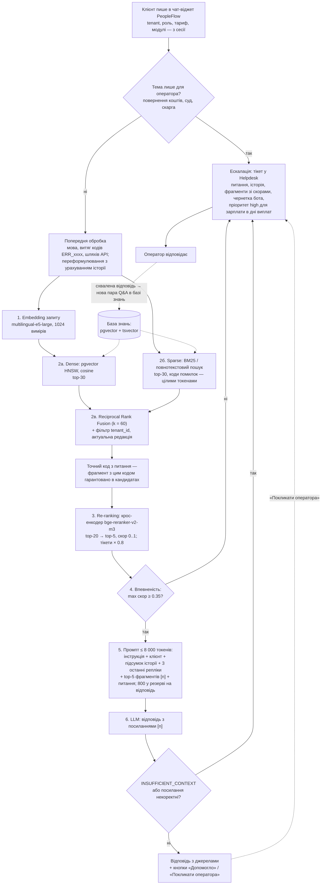
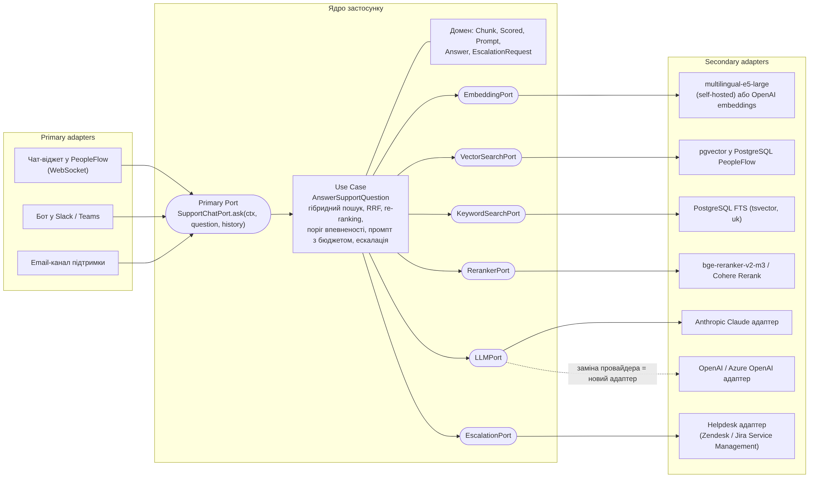

# Лабораторна робота №14. Проєктування RAG-системи для бази знань служби підтримки

Дисципліна: «Програмна інженерія (Software Engineering)»
Виконав: Бруско Максим, група МФ-51.

**Варіант 1 — «PeopleFlow»**, B2B SaaS для управління персоналом і зарплатами. Кількісні дані легенди лишаються без змін:
- ~200 корпоративних клієнтів;
- ~3 000 звернень на тиждень, з них ≥ 60 % — повторювані.

База знань складається з чотирьох джерел:

| Джерело | Обсяг |
|---|---|
| Статті довідкового центру (how-to з кроками і скріншотами) | 340 статей по 200–800 слів |
| Технічна документація **API розрахунку зарплат** (таблиці параметрів, приклади коду, коди помилок на кшталт `ERR_4092`) | 85 сторінок |
| Історія закритих тікетів (питання клієнта + відповідь оператора, багато дублів) | 12 000 тікетів за 2 роки |
| Вікі **кадрової й бухгалтерської політики** (відпустки, календар виплат, закриття періодів) | оновлюється раз на місяць |

Головна відмінність від базової легенди: у тікетах і питаннях трапляються **персональні дані працівників** (РНОКПП, IBAN, зарплати), а помилка бота може коштувати клієнту неправильно нарахованої зарплати. Тому в архітектурі є знеособлення, жорсткі теми «лише для людини» і пріоритетна ескалація в дні виплат.

Лабораторна — про архітектуру. Код у репозиторії — прототип у стилі портів і адаптерів (Лаба 3). Він перевіряє рішення на демонстраційній базі знань ([`data/sample_kb/`](data/sample_kb/)): chunking, гібридний пошук, поріг впевненості, ескалацію, бюджет промпту і заміну LLM-провайдера. Моделі (embeddings, re-ranker, LLM) у прототипі замінено заглушками: мережа до них недоступна, а суть лаби — оркестрація, а не якість конкретної моделі.

```
python demo_chunking.py     # Завдання 1: fixed-size vs структурний chunking  -> results/chunking_demo.txt
python estimates.py         # Завдання 2: обсяг фрагментів, пам'ять, QPS        -> results/estimates.txt
python demo_pipeline.py     # Завдання 3: конвеєр запиту, 6 сценаріїв           -> results/pipeline_demo.txt
pytest -q tests             # 23 тести
```

```
lab14/
├── rag/                 # ядро: domain.py, ports.py, use_case.py, chunking.py, prompt.py, fusion.py, pii.py, metrics.py
├── adapters/memory.py   # адаптери в пам'яті: BM25, векторне сховище, заглушки моделей, Helpdesk
├── kb.py                # інжест демонстраційної бази знань
├── data/sample_kb/      # уривки: API розрахунків, 2 статті, 2 сторінки політик, 6 тікетів з вигаданими PII
├── docs/                # pipeline.mmd/png (Завдання 3), hexagonal.mmd/png (Завдання 5)
└── tests/               # test_chunking.py, test_pipeline.py, test_metrics.py
```

Потрібен лише Python 3.10+ і pytest.

## Завдання 1. Стратегія chunking

Обрано **гібридну стратегію: для кожного типу контенту свій спосіб різання**. Загальні правила:
- фрагмент не розриває логічну одиницю: крок інструкції, рядок таблиці, блок коду, пункт політики;
- **кожен фрагмент починається з контекстного заголовка** (назва документа + розділ / endpoint), щоб бути зрозумілим без сусідів;
- ліміт — ~350 токенів (у межах 512-токенного вікна embedding-моделі);
- метадані (тип джерела, endpoint, коди помилок, дата редакції, `tenant_id`) зберігаються поруч і використовуються у фільтрах.

| Тип контенту | Стратегія | Чому саме так |
|---|---|---|
| **Статті довідкового центру** (340 × 200–800 слів, кроки, скріншоти) | **Структурна, за заголовками `##`**: одна секція = один фрагмент, нумерований список кроків завжди цілий. На початку — назва статті. Скріншоти перетворюються на текстові підписи (`[Скріншот: …]`). Якщо секція задовга — semantic-поділ за межею зміни теми, але не всередині списку | Питання клієнтів — це «як зробити X», а відповідь — повна послідовність кроків. Фрагмент з кроками 3–5 без 1–2 дасть інструкцію, яку неможливо виконати. Статті вже мають добру структуру, тож заголовки — природні межі |
| **Документація API розрахунку зарплат** (85 сторінок, таблиці, код, коди помилок) | **Структурна, за endpoint**: опис + **вся** таблиця параметрів + приклад запиту. Довгу таблицю ріжемо по групах рядків, **повторюючи шапку і назву endpoint**. **Окремий фрагмент на кожен код помилки** у вигляді речення «`POST /v2/payroll/runs` — помилка `ERR_4092` (HTTP 409). Значення… Що робити…». Код не ріжеться ніколи | Таблиця має сенс лише цілою: рядок `\| tax_profile \| enum \| так \|` без шапки й без endpoint — набір слів. Коди помилок шукають точно («у мене ERR_4092»), тому кожен код — окремий маленький фрагмент з кодом у метаданих для точного збігу |
| **Історія тікетів** (12 000, багато дублів) | **Один фрагмент = пара «питання — фінальна відповідь оператора»**, без проміжного листування. Перед індексацією: **знеособлення** (РНОКПП, IBAN, телефони, email, імена) і **злиття майже-дублікатів** (у проді — косинусна схожість > 0,92; у прототипі — схожість множин слів ≥ 0,5). Тікетам — нижча довіра (×0,8 до скору) і TTL: застарілі (зміна версії продукту, > 12 міс.) виключаються | Тікет — це вже готова пара Q&A, різати її безглуздо. Дублі забивали б top-5 однаковими фрагментами. PII іншого клієнта в контексті бота — витік персональних даних (Закон «Про захист персональних даних», GDPR) |
| **Вікі кадрової / бухгалтерської політики** (оновлення раз на місяць) | **Структурна / semantic за пунктами політики**: один пункт (тривалість відпустки, перенесення, компенсація) = фрагмент, з назвою політики й **датою редакції** в метаданих. При оновленні сторінки **всі її старі фрагменти замінюються в одній транзакції** | Політики цитують дослівно, і змішування редакцій небезпечне: «24 дні» з нової редакції і «компенсація щороку» зі старої дадуть юридично хибну відповідь. Дата редакції в промпті дозволяє LLM сказати «за політикою від 01.09.2026» |

### Чому fixed-size особливо небезпечний для таблиці параметрів API

Візьмемо уривок документації PeopleFlow ([`data/sample_kb/api_payroll_runs.md`](data/sample_kb/api_payroll_runs.md)): endpoint `POST /v2/payroll/runs` з таблицею з 6 параметрів і таблицею кодів помилок `ERR_4091`–`ERR_4093`, `ERR_4221`. Нарізаємо його «як у туторіалі» — по 400 символів з перекриттям 50 ([`results/chunking_demo.txt`](results/chunking_demo.txt)):

```
--- chunk 2: 400 символів
к | Період нарахування. Період має бути відкритим |
| legal_entity_id | uuid | так | Юрособа-роботодавець |
| employee_ids | array of uuid | ні | Якщо не вказано, беруться всі активні працівники юрособи |
| include_bonuses | boolean | ні | Додати премії з модуля Bonuses. За замовчуванням false |
| tax_profile | enum: general, simplified, diia_city | так | Податковий режим: загальний, ФОП-спрощений
   !!! рядки таблиці без шапки: невідомо, що означає кожна колонка
   !!! рядки без назви свого endpoint: це POST /runs чи GET /runs/{id}?
   !!! починається посеред рядка
   !!! рядок таблиці розрізано
```

**Проблемні всі 6 фрагментів з 6.** Що конкретно ламається:
1. **Рядки без шапки.** У фрагменті «`| tax_profile | enum… | так |`» немає рядка `| Параметр | Тип | Обов'язковий | Опис |`. LLM не знає, що «так» означає «обов'язковий», і може відповісти, що `tax_profile` необов'язковий. Клієнт надішле запит без нього і отримає `ERR_4221`.
2. **Рядки без endpoint.** Ті самі назви параметрів є і в `POST /v2/payroll/runs`, і в `GET /v2/payroll/runs/{id}`. Фрагмент без назви endpoint може бути приписаний не тому методу.
3. **Змішування endpoint.** У фрагменті 5 рядок `ERR_4221` (помилка POST) опинився під заголовком `## GET /v2/payroll/runs/{id}`, тож модель припише помилку GET-запиту.
4. **Розрізаний рядок коду помилки:** `| ERR_4221 | 422 | Невідомий ` | `tax_profile | Допустимі значення…`. Пошук за `ERR_4221` знайде фрагмент, де немає відповіді «що робити».
5. **Перекриття не рятує:** 50 символів — це пів рядка таблиці.

**Як уникаємо** (`rag/chunking.py`, `api_doc_chunks`):
- фрагмент = endpoint цілком: опис, таблиця параметрів, приклад;
- коди помилок — окремими фрагментами-реченнями з кодом у метаданих;
- кожен фрагмент починається з `Payroll API v2 — …` + назва endpoint;
- якщо endpoint більший за ліміт (у демо — 150 токенів), опис іде окремо, а таблиця ріжеться по групах рядків. Кожна група повторює шапку таблиці й назву endpoint.

Результат на тому ж документі: **7 фрагментів, проблемних 0**. Тести: `tests/test_chunking.py`.

## Завдання 2. Vector database

**Обсяг після chunking** ([`results/estimates.txt`](results/estimates.txt), рахує `estimates.py`):

| Джерело | Розрахунок | Фрагментів |
|---|---|---|
| Статті | 340 × 500 слів = 170 000 слів / ~180 слів на секцію | **945** |
| API | 85 стор. × 2 endpoint × 1,3 (довгі таблиці) = 221 + 85 × 4 коди помилок = 340 | **561** |
| Тікети | 12 000 × 0,4 (після злиття дублів) × 0,7 (без «дякую, закриваємо» і разових) | **3 360** |
| Вікі політик | 25 сторінок × 800 слів / ~150 слів на пункт | **134** |
| **Разом** | | **≈ 5 000** (без злиття тікетів — 13 640) |

- **Пам'ять:** вектор 1024 × 4 Б = 4 КБ. 5 000 × 4 КБ × 1,5 (накладні HNSW) ≈ **29 МБ**, навіть без злиття тікетів — 80 МБ. Тексти — ще ~10 МБ.
- **Навантаження:** 3 000 звернень × 2,5 питання = 7 500 питань на тиждень. За 50 робочих годин це 150 на годину, тобто **0,04 QPS** у середньому. Пік — дні виплат (20-те, 3–5-те числа) плюс ранок понеділка, хвилинний сплеск ×50 ≈ **2 QPS**. Закладаємо **5 QPS**: це 10 запитів до БД за секунду (dense + sparse).

**Вибір: pgvector в окремій схемі PostgreSQL, який PeopleFlow уже використовує.**

1. **Обсяг і навантаження мізерні для спеціалізованої векторної БД.** 5 000 векторів і 5 QPS — це десятки мегабайт, і HNSW-індекс увесь у пам'яті. Окремий кластер Qdrant / Weaviate чи платний Pinecone тут — нова інфраструктура, моніторинг і бекапи без жодного виграшу у швидкості.
2. **Транзакційна консистентність потрібна.** Вона є саме тут, і саме вона вирішує вибір:
   - **Оновлення політик.** Сторінку «Відпустки» замінюємо так: `BEGIN; DELETE FROM kb_chunks WHERE doc_id = 'policy_vacation'; INSERT …нові фрагменти…; COMMIT;`. Бот ніколи не побачить суміші старої й нової редакції.
   - **Видалення даних клієнта.** Клієнт іде або вимагає видалити дані (право на забуття). Тікети в основній БД і їхні фрагменти в індексі видаляються **однією транзакцією**. В окремій векторній БД це був би dual write з ризиком «тікет видалено, а фрагмент з його текстом лишився» (Лаба 7).
   - **Фільтри за метаданими — звичайний SQL.** `WHERE tenant_id IS NULL OR tenant_id = :tenant`, `AND status = 'current'`, `JOIN` з таблицею підписок (які модулі в клієнта). Метадані не треба синхронізувати в інше сховище.
3. **Sparse-пошук у тій самій БД.** Колонка `tsvector` з українським словником (hunspell `uk_UA`) і GIN-індекс, окремо `error_codes text[]` з GIN для точного збігу кодів. Гібридний запит (Завдання 3) — це **один SQL-запит** з двома CTE і RRF, без двох систем.
4. **Дані не виходять за периметр.** Тікети, навіть знеособлені, стосуються зарплат і кадрів. Тримати їх у сторонньому SaaS (Pinecone) — додаткове юридичне питання для 200 корпоративних клієнтів.

Схема: `kb_chunks(id, doc_id, source, title, text, embedding vector(1024), tsv tsvector, error_codes text[], tenant_id, edition, status, updated_at)`, індекс `HNSW (embedding vector_cosine_ops) WITH (m = 16, ef_construction = 64)`.

**Коли вибір перестане бути правильним і треба мігрувати на спеціалізовану БД (Qdrant / Weaviate):**
- **Обсяг > ~10 млн векторів.** Наприклад, PeopleFlow вирішить індексувати внутрішні документи кожного з 200 клієнтів (положення, накази, колдоговори — по 50 000 фрагментів на клієнта = 10 млн). HNSW-індекс займе десятки ГБ RAM, а його перебудова — години.
- **Навантаження > ~100–200 QPS векторного пошуку з p95 < 100 мс.** Наприклад, бот відкриють не лише HR-адмінам, а **всім працівникам** клієнтів (~100 000 людей) з питаннями «коли зарплата» і «скільки днів відпустки лишилось».
- **Векторний пошук почне заважати розрахунку зарплат.** Обидва піки припадають на ті самі дні виплат. Перший крок — винести `kb_chunks` на окремий інстанс PostgreSQL. Якщо не вистачить — спеціалізована БД з шардингом, квантизацією і нативними sparse-векторами (SPLADE) для гібридного пошуку.
- **Потрібні функції, яких немає в pgvector:** multi-vector / late interaction (ColBERT), тисячі окремих колекцій на клієнта.

Міграція дешева: use case працює з `VectorSearchPort` (Завдання 5), тому достатньо нового адаптера і переіндексації.

## Завдання 3. Повний конвеєр запиту



Джерело схеми — [`docs/pipeline.mmd`](docs/pipeline.mmd). Реалізація оркестрації — `rag/use_case.py`, `AnswerSupportQuestion.ask`.

**0. Вхід і жорсткі правила.**
- Клієнт пише в чат-віджет PeopleFlow. З сесії вже відомі `tenant_id`, роль (`payroll_admin`, `chief_accountant`, `hr`), тариф і підключені модулі.
- Теми «лише для людини» не йдуть у LLM: повернення коштів за підписку, скасування, скарги, юридичні спори. Ці теми перевіряються одразу.

**Попередня обробка.**
- Визначення мови.
- Витяг точних ідентифікаторів регулярними виразами: коди `ERR_\d{4}`, шляхи `/v2/...`, назви параметрів.
- Якщо є історія — переформулювання follow-up у самостійне питання дешевою моделлю: «а для ФОП?» → «Який tax_profile для ФОП у POST /v2/payroll/runs?».

**1. Embedding запиту.** Та сама модель, що й для документів: `multilingual-e5-large` (1024 виміри). Вона багатомовна, бо питання українською, а назви параметрів англійською. Модель розгорнута у себе, щоб текст питань не йшов назовні.

**2. Пошук — гібридний (dense + sparse), об'єднання Reciprocal Rank Fusion.**
- **Dense** (pgvector, cosine, top-30) знаходить перефразування. «Місяць заблоковано, не дає перерахувати платню» не має жодного спільного слова з «Період нарахування закрито», але за змістом це те саме.
- **Sparse** (повнотекстовий пошук / BM25, top-30) знаходить **точні коди**. Для embedding-моделі `ERR_4092` — це кілька subword-токенів (`ERR`, `_`, `40`, `92`). Фрагменти `ERR_4091`, `ERR_4092` і `ERR_4093` написані за одним шаблоном і відрізняються однією цифрою, тож їхні вектори майже однакові, і dense-пошук не гарантує, що першим буде потрібний. А для BM25 `ERR_4092` — один рідкісний токен з високим IDF, і збіг точний. Тому токенізатор налаштовано так, щоб коди й шляхи API були одним токеном.
- **RRF** (`score = Σ 1 / (60 + rank)`) об'єднує два списки без калібрування різних шкал скорів. Документ, знайдений обома способами, піднімається вгору.
- **Закріплення точного коду.** Якщо в питанні є `ERR_xxxx`, фрагмент з цим кодом в `error_codes` гарантовано потрапляє в кандидати, причому офіційна документація стоїть перед тікетами.
- **Фільтри:** `tenant_id` (спільна база + приватні фрагменти цього клієнта), лише актуальні редакції.

Перевірка на демо-базі ([`results/pipeline_demo.txt`](results/pipeline_demo.txt)) показує, чому одного BM25 замало:

```
точні ідентифікатори (коди, параметри)   Hit@5 = 100%, MRR = 0.90
перефразовані, без слів з документа      Hit@5 = 60%,  MRR = 0.40
```

Саме другу групу закриває dense-пошук. Його якість на справжній моделі вимірюється метрикою Recall@5 із Завдання 4.

**3. Re-ranking — так.** Крос-енкодер `bge-reranker-v2-m3` (багатомовний) переранжує top-20 після RRF до top-5.
- Він бачить питання і фрагмент **разом**, тож точніше за bi-encoder розрізняє «ERR_4092 при створенні» і «ERR_4092 при отриманні».
- При 5 QPS додаткові 100–200 мс не критичні.
- Його скор 0..1 — **міра впевненості** для кроку 4.
- Тікетам — множник 0,8: вони можуть бути застарілими і стосуватися одного клієнта.

**4. Поріг впевненості.**
- Якщо найкращий скор < **0,35** — ескалація **без виклику LLM**: немає контексту — немає чого генерувати.
- Між 0,35 і 0,6 — відповідь + кнопка «Покликати оператора» одразу під нею.

**5. Побудова промпту** (`rag/prompt.py`). Складові по черзі:

| # | Складова | Бюджет, токенів |
|---|---|---|
| 1 | Системна інструкція: роль, «відповідай лише з фрагментів [n] і посилайся на них», «нема відповіді → `INSUFFICIENT_CONTEXT`», без юридичних висновків щодо конкретних працівників, без даних інших клієнтів, мова відповіді = мова питання | ~150 |
| 2 | Контекст клієнта: тариф, роль, підключені модулі (щоб не радити модуль, якого в клієнта немає) | ~50 |
| 3 | Підсумок старої частини діалогу | ≤ 1 500 разом з п. 4 |
| 4 | Останні 3 репліки дослівно | |
| 5 | Top-5 фрагментів з номерами `[1]..[5]`, джерелом, назвою і датою редакції — у порядку релевантності | ~5 000 (решта бюджету) |
| 6 | Питання клієнта (оригінал + переформульоване) | ~200 |
| — | Резерв на відповідь | 800 |
| | **Разом** | **≤ 8 000** |

Бюджет 8 000 токенів обрано свідомо, хоча моделі приймають 100 000+. Довший контекст — це дорожче (7 500 питань на тиждень), повільніше і гірше: модель губить важливе в середині довгого контексту.

**Якщо історія діалогу довга:**
1. Останні 3 репліки йдуть дослівно, але кожна не довша за свою частку бюджету.
2. Старіші репліки стискаються в **підсумок** дешевою моделлю (`LLMPort.summarize`). Підсумок зберігає факти: коди помилок, endpoint, модуль, що клієнт уже пробував.
3. Підсумок оновлюється інкрементально раз на кілька реплік, а не перераховується щоразу.
4. Якщо не влазить і так — відкидаються **найнижчі за рангом фрагменти**. Інструкція й питання не скорочуються ніколи.

У демо 24 репліки історії стиснуті до підсумку 858 + останні репліки 499 токенів (≤ 1 500), а весь промпт — 1 955 токенів.

**6. Генерація і перевірка.**
- LLM відповідає з посиланнями `[n]`.
- Якщо відповідь — `INSUFFICIENT_CONTEXT` або в ній немає коректних посилань на надані фрагменти, це ескалація (з чернеткою відповіді для оператора).
- Клієнт отримує відповідь з посиланнями на статті та кнопками «Допомогло» / «Покликати оператора».

**Сценарій ескалації до оператора.**
- **Тригери:**
  - тема «лише для людини»;
  - впевненість < 0,35;
  - `INSUFFICIENT_CONTEXT`;
  - некоректні посилання;
  - клієнт натиснув «Покликати оператора»;
  - два «Не допомогло» поспіль в одній розмові.
- **Що створюється** (`EscalationPort.create_ticket`): тікет у Helpdesk з питанням, **усією історією**, top-5 фрагментами зі скорами, кодами з питання, тарифом і роллю, а також **чернеткою бота** (якщо була). Оператор не перепитує клієнта і може почати з чернетки.
- **Пріоритет `high`** — для зарплатних тем (зарплата, розрахунок, виплата, `ERR_409x`) і тарифу enterprise. Якщо завтра виплата, а розрахунок не створюється, працівники клієнта не отримають гроші вчасно.
- **Клієнт** бачить: «Передаю спеціалісту, номер звернення SUP-…». Очікуваний час береться з SLA його тарифу у вікі політик.
- **Зворотний зв'язок:** схвалена відповідь оператора після перевірки стає новою парою Q&A в базі. Щотижневий звіт «теми без відповіді» показує, які статті треба написати.

**Що показало демо** (`python demo_pipeline.py`):

| Сценарій | Результат |
|---|---|
| «Отримую ERR_4092 при POST /v2/payroll/runs, що робити?» | відповідь з посиланням на фрагмент `ERR_4092` з документації API (не на тікет), впевненість 0,86 |
| «Не можу порахувати зарплату за жовтень, пише що місяць закритий» | відповідь за тікетом-аналогом; у top-3 також пункти політики про закриття періоду |
| «Як налаштувати вивантаження в 1С через SFTP?» (у базі немає) | впевненість 0,00 → **ескалація без виклику LLM**, оператору передано 5 фрагментів |
| «Хочу повернення коштів за минулий місяць підписки» | **ескалація за темою**, LLM не викликався |
| 24 репліки історії + питання про відпустку | підсумок історії, промпт 1 955 токенів, відповідь «24 календарні дні» з політики |
| Той самий запит з іншим LLM-адаптером | інший текст, ті самі джерела, use case не змінювався |

## Завдання 4. Метрики оцінювання якості

### Метрика 1. Faithfulness (RAGAS) — чи не вигадує модель

**(а) Що вимірює і як обчислюється.** Частку тверджень у відповіді, які підтверджує наданий контекст.
1. LLM-суддя розбиває відповідь на атомарні твердження.
2. Для кожного перевіряє, чи випливає воно з top-5 фрагментів (так / ні).
3. `Faithfulness = підтверджені / усі`.

Рахуємо щодня на випадковій вибірці 5 % відповідей і на **всіх** відповідях з «Не допомогло». Поріг тривоги — середнє < 0,9 за день. Окремо — будь-яка відповідь з Faithfulness < 0,5 у темах «зарплата» і «відпустки».

**(б) Що виявляє тільки вона.**
- **Ситуація.** HR-менеджер питає: «Чи можна виплатити працівнику компенсацію за невикористану відпустку, не звільняючи його?». Пошук знайшов правильний пункт політики «Компенсація» (з Recall@5 усе гаразд). Бот відповідає: «Так, компенсацію можна виплачувати щороку за всі невикористані дні [1]».
- **Що каже політика.** Під час роботи компенсація можлива лише за дні **понад 24**. Модель «доповнила» відповідь загальними знаннями.
- **Чому інші метрики мовчать.** Відповідь звучить переконливо, менеджер задоволений і не створює тікет, тож Resolution Rate теж у нормі. Помилка вилізе на перевірці податкової.
- **Що бачить Faithfulness.** Твердження «щороку за всі дні» не підтверджене фрагментом [1], тож метрика = 0.

### Метрика 2. Recall@5 і MRR на золотому наборі — чи знаходить пошук потрібне (без LLM)

**(а) Що вимірює і як обчислюється.** Чи потрапляє потрібний фрагмент у top-5 пошуку і на якому місці.
- **Золотий набір:** 400 пар «питання → id правильних фрагментів». 300 узято із закритих тікетів, де оператор дав посилання на статтю, і ще 100 — по одному-два питання на кожен код помилки.
- **Формули:** `Recall@5 = |top-5 ∩ правильні| / |правильні|`, `MRR = середнє 1 / позиція першого правильного` (`rag/metrics.py`). Жодного виклику LLM — це звичайне порівняння списків.
- **Коли рахуємо:** у CI на кожну зміну chunking, токенізатора, embedding-моделі чи параметрів індексу, а також щоночі.
- **Пороги:** Recall@5 ≥ 0,9 загалом і ≥ 0,98 на підмножині з кодами помилок. Інакше реліз блокується.

**(б) Що виявляє тільки вона.**
- **Ситуація.** Команда переходить на нову версію embedding-моделі або міняє конфігурацію повнотекстового пошуку на `simple`, яка розбиває `ERR_4092` на `err` і `4092`. Після цього на питання з `ERR_4092` першими повертаються фрагменти `ERR_4091` і `ERR_4093`.
- **Чому інші метрики мовчать.** Бот чесно переказує фрагмент `ERR_4093`: «створіть коригувальний розрахунок» [1]. Це **faithful** відповідь, бо вона повністю підтверджена контекстом, тож Faithfulness = 1. Resolution Rate просяде лише через кілька днів, коли клієнти нароблять зайвих коригувальних розрахунків.
- **Що бачить Recall@5.** Recall@5 на підмножині кодів падає з 0,98 до ~0,3 **ще в CI, до релізу**. Тест `test_recall_at_k_catches_neighbouring_error_code` моделює саме цей випадок.

### Метрика 3. Resolution Rate — чи справді бот вирішив проблему (без LLM)

**(а) Що вимірює і як обчислюється.** Частка розмов, де бот відповів без ескалації і **той самий користувач не створив тікет на ту саму тему протягом 72 годин**.
- **Формула:** `Resolution Rate = розмови без ескалації і без повернення / усі розмови` (`rag/metrics.py`, `resolution_rate`). Тема визначається тегом статті-джерела.
- **Звідки дані:** лише журнали подій чату й Helpdesk, без LLM.
- **Коли рахуємо:** щотижня по кожній темі. Тривога — падіння на > 10 п.п. за тиждень у будь-якій темі.
- **Доповнення:** кнопки «Допомогло» / «Не допомогло». Вони швидші, але натискає їх лише ~10 % користувачів.

**(б) Що виявляє тільки вона.**
- **Ситуація.** У листопаді Пенсійний фонд змінив формат електронних лікарняних. У PeopleFlow кнопка «Провести» стала «Підтвердити» і переїхала в інше меню. Стаття «Як провести електронний лікарняний» не оновлена.
- **Чому інші метрики мовчать.** Пошук знаходить саме цю статтю, і золотий набір вказує на неї, тож Recall@5 = 1. Бот дослівно переказує кроки, тож Faithfulness = 1. Обидві метрики «зелені».
- **Що бачить Resolution Rate.** Кадровики не знаходять кнопку і за день створюють тікети. Метрика для теми «лікарняні» падає з ~78 % до ~40 %. Лише вона ловить **застарілий контент**: проблема не в пошуку і не в генерації, а в самій базі знань.

### Разом

| Проблема | Faithfulness | Recall@5 / MRR | Resolution Rate |
|---|---|---|---|
| Модель вигадала факт, якого немає в контексті | **ловить** | ні | ні (користувач не помічає) |
| Пошук повертає сусідній код помилки | ні (відповідь вірна контексту) | **ловить, до релізу** | лише через дні |
| Стаття застаріла | ні | ні | **ловить** |

## Завдання 5. Архітектурна діаграма (Hexagonal Architecture)



Джерело — [`docs/hexagonal.mmd`](docs/hexagonal.mmd). Код відповідає схемі один до одного: `rag/ports.py`, `rag/use_case.py`, `adapters/memory.py`.

- **Центральний use case — `AnswerSupportQuestion`.** Він оркеструє RAG-запит: гібридний пошук, RRF, закріплення коду, re-ranking, поріг впевненості, промпт з бюджетом, перевірку посилань, ескалацію. Use case залежить лише від портів і доменних об'єктів (`Chunk`, `Scored`, `Prompt`, `Answer`, `EscalationRequest`). `Prompt` — нейтральна до провайдера структура.
- **Primary Port — `SupportChatPort.ask(ctx, question, history)`.** Через нього приходять запити клієнтів. Адаптери: чат-віджет у PeopleFlow (WebSocket), бот у Slack / Teams, email-канал підтримки.
- **Secondary Ports і адаптери:**

| Порт | Адаптер у проді | Адаптер у тестах |
|---|---|---|
| `EmbeddingPort` | `multilingual-e5-large` (self-hosted) або OpenAI embeddings | `HashingEmbedding` |
| `VectorSearchPort` | pgvector у PostgreSQL | `InMemoryVectorStore` |
| `KeywordSearchPort` | PostgreSQL FTS (`tsvector`, український словник) | `BM25Index` |
| `RerankerPort` | `bge-reranker-v2-m3` / Cohere Rerank | `OverlapReranker` |
| `LLMPort` | адаптер Anthropic Claude; адаптер OpenAI / Azure OpenAI | `ScriptedLLM`, `TemplateLLM` |
| `EscalationPort` | Helpdesk (Zendesk / Jira Service Management) | `InMemoryEscalation` |

**Перевага для PeopleFlow, якщо за пів року компанія змінить LLM-провайдера через ціни.**
- **Що змінюється.** Пишемо один новий адаптер `LLMPort` (~100 рядків: автентифікація, перетворення нейтрального `Prompt` у формат API нового провайдера, streaming, обробка помилок) і перемикаємо конфіг.
- **Що лишається як є.** Use case, правила промпту, пороги впевненості, ескалація, індекси й тести не змінюються.
- **Як переходимо безпечно.** Обидва адаптери можна тримати паралельно і порівняти на реальному трафіку за Faithfulness і Resolution Rate. Відкат — знову лише конфіг.

Тест `test_switching_llm_provider_changes_only_the_adapter` і сценарій 6 демо показують саме це: інший адаптер дає інший текст, але ті самі джерела, і контекст, переданий у LLM, ідентичний.

Заміна **embedding-провайдера** теж локалізована в адаптері, але дорожча: вектори іншої моделі несумісні, тому потрібна переіндексація всіх ~5 000 фрагментів. Її робимо blue/green: новий індекс будується поруч, і перемикання відбувається конфігом.

## AI Usage — декларування використання ШІ

[ ] Під час виконання цієї лабораторної роботи інструменти генеративного ШІ НЕ використовувалися.

[X] Під час виконання цієї лабораторної роботи використовувалися інструменти ШІ як допоміжний засіб.

| Інструмент ШІ | Промпт / задача, делегована ШІ |
|---|---|
| Claude (Anthropic) | 1. Надіслано PDF умови лабораторної №14, варіант 1 (PeopleFlow). 2. «Давай рухатися далі до 14 лаби» — ШІ склав демонстраційну базу знань, обґрунтував chunking для кожного типу контенту, порахував обсяг і навантаження, обрав векторну БД, спроєктував конвеєр запиту і метрики, написав прототип у стилі портів і адаптерів з 23 тестами, намалював дві схеми, запустив усе і підготував README. 3. «Зроби шпаргалку до захисту в репозиторії для кожної лаби» — ШІ підготував `cheatsheets/lab14.md`. |
