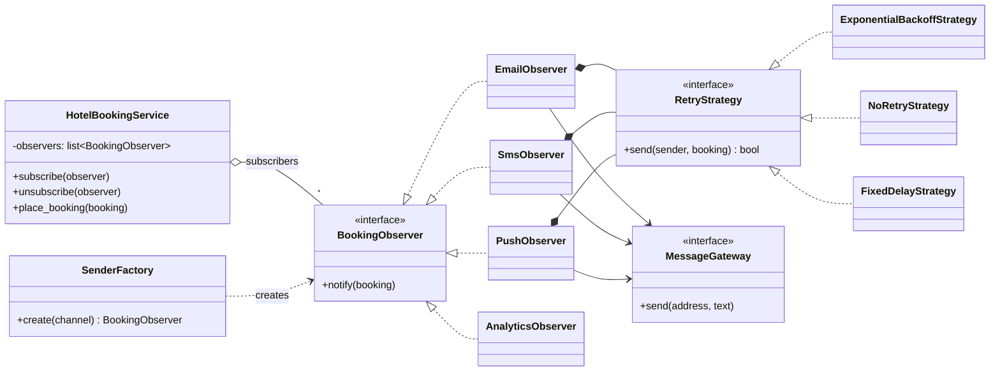

# Лабораторна робота №2. Патерни GoF — Observer, Strategy, Factory Method

Дисципліна: «Програмна інженерія (Software Engineering)»
Виконав: Бруско Максим, група МФ-51. **Варіант 1** — `HotelBookingService` мережі готелів: підтвердження бронювання номера надсилається гостю Email і SMS, а внутрішній команді пишеться в аналітичний журнал.

Мова: Python 3.10+. Запуск: `python main.py`. Перевірка: `python test_notifications.py`.

## Структура

```
lab2/
├── original/hotel_booking_service.py          # вихідний код, номери рядків нижче — звідси
├── notifications/
│   ├── models.py                      # Guest, Booking                      (Завд. 2)
│   ├── booking_service.py             # HotelBookingService — Subject               (Завд. 2)
│   ├── observers/
│   │   ├── base.py                    # BookingObserver                        (Завд. 2)
│   │   ├── email_observer.py          # EmailObserver                        (Завд. 2)
│   │   ├── sms_observer.py            # SmsObserver                          (Завд. 2)
│   │   ├── analytics_observer.py      # журнал аналітики                     (Завд. 2)
│   │   └── push_observer.py           # PushObserver                         (Завд. 4, новий)
│   ├── retry/
│   │   ├── base.py                    # RetryStrategy                        (Завд. 3)
│   │   ├── exponential_backoff.py     # для Email                            (Завд. 3)
│   │   ├── no_retry.py                # для SMS                              (Завд. 3)
│   │   └── fixed_delay.py             # FixedDelayStrategy                   (Завд. 4, новий)
│   ├── gateways/                      # транспорт: консоль і шлюз зі збоями для демо
│   └── factory/sender_factory.py      # SenderFactory — Factory Method       (Завд. 4, новий)
├── main.py
└── test_notifications.py
```

## Завдання 1. Аналіз та Code Review

**Порушення SRP.** `place_booking` (рядки 2–13) відповідає водночас за збереження бронювання (3), за сповіщення гостя (6–9) і за аналітику (11). Зміна формату SMS, нова вимога до аналітики чи зміна збереження — усе це правки одного методу.

**Порушення OCP.**
- **Рядки 6–9.** Кожен канал — окремий `if`. Щоб додати Push чи Telegram, доведеться правити сам `place_booking`.
- **Рядок 11.** Аналітику «додали окремим патчем прямо тут» — це саме те, від чого OCP захищає: нова поведінка з'являється через зміну вже робочого коду.

**Немає обробки збоїв (рядок 13).** Помилка надсилання мовчки ігнорується. Логіки повторів немає, а вона має бути різною: email може почекати і спробувати пізніше, SMS — ні, бо кожна спроба коштує грошей.

**Обрані патерни: Observer + Strategy.**
- **Observer** розв'язує проблему каналів. `HotelBookingService` стає Subject і викликає `notify(booking)` для кожного підписника, не знаючи, скільки їх і які вони. Новий канал — це новий підписник, а не новий `if`. Аналітика теж стає підписником.
- **Strategy** розв'язує проблему повторів. Політика повторів — окрема змінна поведінка, яку кожен канал отримує ззовні. Її можна міняти, не чіпаючи сам канал.

**Чому не інші патерни.**
- **Chain of Responsibility** передає запит, доки його не обробить *один* обробник. А нам потрібно, щоб спрацювали *всі* канали.
- **Decorator** підійшов би, щоб обгорнути один відправник повтором. Але проблему множинних каналів він не розв'язує, і обгортки довелося б збирати вручну для кожного каналу.
- **Mediator** — для двостороннього обміну між кількома об'єктами. Тут потік односторонній: подія → підписники.

## Завдання 2. Observer

- `HotelBookingService` зберігає список `BookingObserver` і має методи `subscribe` / `unsubscribe`. У `place_booking` він просто викликає `notify(booking)` для кожного підписника.
- `EmailObserver`, `SmsObserver`, `AnalyticsObserver` — окремі класи зі спільним інтерфейсом `BookingObserver`.
- Підписка відбувається один раз при налаштуванні застосунку в `main.py`, а не всередині `place_booking`.
- Прапорці `wants_email` / `wants_sms` замінено набором `Guest.channels`. Кожен канал сам перевіряє, чи погодився на нього гість. Так новий канал не вимагає нового поля в моделі — це знадобилося в Завданні 4.

## Завдання 3. Strategy

- Інтерфейс `RetryStrategy.send(sender, booking) -> bool`.
- `ExponentialBackoffStrategy` — для Email: паузи base, 2·base, 4·base…
- `NoRetryStrategy` — для SMS: рівно одна спроба.
- `EmailObserver` і `SmsObserver` отримують стратегію через конструктор (DI) і надсилають **через неї**: `self._retry.send(self._send, booking)`. Повтори не захардкожені в Observer'ах.
- Транспорт (`MessageGateway`) теж передається через конструктор. Тому в демо можна підставити `FlakyGateway`, який імітує збої мережі.

## Завдання 4. Розширення без зміни наявного коду

Додано три **нові** файли, жоден файл із Завдань 2–3 не редагувався:

1. **`observers/push_observer.py`** — `PushObserver`.
2. **`retry/fixed_delay.py`** — `FixedDelayStrategy`, однакова пауза між спробами.
3. **`factory/sender_factory.py`** — `SenderFactory.create("email" | "sms" | "push")` повертає готовий Observer з правильною стратегією:
   - email → ExponentialBackoff;
   - sms → NoRetry;
   - push → FixedDelay.

**Чому нічого не довелося правити:**
- **`HotelBookingService` працює з абстракцією `BookingObserver`.** Новий підписник для нього нічим не відрізняється від старих.
- **Observer'и працюють з абстракцією `RetryStrategy`.** Нова стратегія підходить будь-якому з них.
- **Канали гостя зберігаються як набір рядків.** `PushObserver` перевіряє `guest.wants("push")` без нового поля в моделі.
- **Знання «який канал з якою стратегією» живе лише у фабриці.** Клієнтський код (`main.py`) нічого не збирає вручну.
- **У `HotelBookingService` немає `isinstance` і немає `if channel == ...`.** Це перевіряє тест `test_booking_service_has_no_type_checks`.

Результат `python main.py` (email падає двічі, SMS і push — по разу):

```
=== Бронювання 1: email + sms + push ===
Saving booking 1...
  [retry] booking 1: attempt 1 failed, waiting 0.1s
  [retry] booking 1: attempt 2 failed, waiting 0.2s
Sending EMAIL to alice@example.com: booking 1 confirmed
  [no-retry] booking 1: failed once, not retrying (network error)
  [fixed-delay] booking 1: attempt 1 failed, waiting 0.1s
Sending PUSH to app-user:alice@example.com: booking 1 confirmed
[ANALYTICS] booking 1 placed, total=1050.0

=== Бронювання 2: лише email ===
Saving booking 2...
Sending EMAIL to bob@example.com: booking 2 confirmed
[ANALYTICS] booking 2 placed, total=99.9
```

Збій одного каналу не зупиняє інші: SMS не дійшло, але push і аналітика спрацювали.

## Завдання 5. UML-діаграма класів



- `o--` — агрегація: Subject тримає список підписників, але не володіє ними.
- `*--` — композиція: кожен Observer володіє своєю стратегією повторів, яку отримує через конструктор.
- `<|..` — реалізація інтерфейсу.
- `PushObserver`, `FixedDelayStrategy`, `SenderFactory` — класи із Завдання 4.

## Декларування використання ШІ

[ ] Під час виконання цієї лабораторної роботи інструменти генеративного ШІ НЕ використовувалися.

[X] Під час виконання цієї лабораторної роботи використовувалися інструменти ШІ як допоміжний засіб.

| Інструмент ШІ | Список промптів або опис задачі, делегованої ШІ |
|---|---|
| Claude (Anthropic) | 1. Надіслано умову лабораторної роботи №2 (GoF). 2. «Зроби все, що можна, з того, що в роботі» — ШІ підготував код патернів, тести, README і UML-діаграму. 3. «Переробити лабу під варіант 1 (мережа готелів)» — ШІ адаптував класи, тести і звіт під `HotelBookingService`. |
