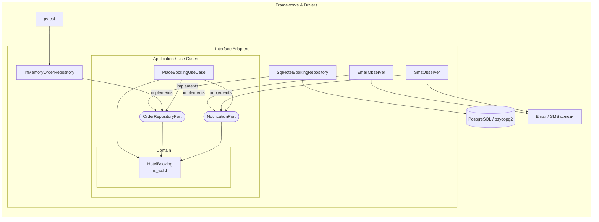

# Лабораторна робота №3. Clean Architecture та Hexagonal Architecture — Ports & Adapters

Дисципліна: «Програмна інженерія (Software Engineering)»
Виконав: Бруско Максим, група МФ-51. **Варіант 1** — `HotelBookingService` мережі готелів.

Мова: Python 3.10+. Запуск: `python main.py`. Тести: `python test_place_booking.py` (або `pytest`).
PostgreSQL і `psycopg2` для тестів не потрібні.

## Структура (за шарами)

```
lab3/
├── original/hotel_booking_service.py    # вихідний код: бізнес-логіка + psycopg2 в одному методі
├── hotel/
│   ├── domain/booking.py                # HotelBooking + is_valid           (Завд. 2)  — Entities
│   ├── application/
│   │   ├── ports.py                     # OrderRepositoryPort, NotificationPort (Завд. 3) — Use Cases
│   │   └── place_booking.py             # PlaceBookingUseCase               (Завд. 4)
│   └── adapters/
│       ├── sql_repository.py            # SqlHotelBookingRepository — єдине місце з SQL і psycopg2
│       ├── in_memory_repository.py      # InMemoryOrderRepository для тестів (Завд. 5)
│       ├── email_observer.py            # EmailObserver  (NotificationPort)
│       └── sms_observer.py              # SmsObserver    (NotificationPort)
├── main.py                              # composition root                  (Завд. 4)
└── test_place_booking.py                # тести без бази                    (Завд. 5)
```

## Завдання 1. Аналіз шарів та порушень

Фрагменти вихідного `place_booking` (`original/hotel_booking_service.py`):

| Шар | Фрагмент вихідного коду | Куди перенесено |
|---|---|---|
| **Entities / Domain** | перевірка `if booking.total <= 0` — бізнес-правило «бронювання має бути платним» | `HotelBooking.is_valid` у `domain/booking.py` (+ правило `nights > 0`) |
| **Use Cases / Application** | порядок кроків: перевірити → зберегти → повідомити гостя; виклик Email/Sms Observer'ів як «повідом усіх» | `PlaceBookingUseCase.execute()`, порти `OrderRepositoryPort` і `NotificationPort` |
| **Interface Adapters** | SQL-запит `INSERT INTO bookings ...` і перетворення полів бронювання в параметри; конкретні `EmailObserver` / `SmsObserver` | `SqlHotelBookingRepository`, `InMemoryOrderRepository`, `EmailObserver`, `SmsObserver` |
| **Frameworks & Drivers** | `self.db.cursor()`, `cursor.execute`, `self.db.commit()`, сам `psycopg2` і сервер PostgreSQL | бібліотека `psycopg2` і PostgreSQL; видимі лише з `adapters/sql_repository.py` |

**Яке правило порушено.** Порушено **Dependency Rule**: залежності в коді мають бути спрямовані лише всередину, до бізнес-правил. У вихідному коді навпаки: внутрішній шар (бізнес-логіка `place_booking`) залежить від найзовнішнього (psycopg2-конектор і SQL).

**Чому psycopg2 не повинен бути видимим з файлу бізнес-логіки.**
- Правило «total > 0» не залежить від того, де зберігаються дані. Але щоб його перевірити тестом, зараз потрібна жива PostgreSQL.
- Щоб замінити базу, треба правити SQL прямо у сервісі, тобто міняти бізнес-логіку через технічну деталь.
- Будь-яка зміна драйвера чи схеми таблиці ламає найважливіший і найстабільніший код.

## Завдання 2. Чистий Domain-шар

`hotel/domain/booking.py`:
- клас `HotelBooking` (frozen dataclass) — лише дані бронювання;
- властивість `is_valid`: `total > 0 and nights > 0`;
- на початку файлу докстрінг: «цей файл не має жодних зовнішніх залежностей, за жодних обставин»;
- єдиний імпорт — `dataclasses` зі стандартної бібліотеки.

## Завдання 3. Порти

`hotel/application/ports.py` — два абстрактні класи (ABC) без реалізації:
- `OrderRepositoryPort.save(booking)` — «збережи бронювання»;
- `NotificationPort.notify(booking)` — «повідом про бронювання».

Файл імпортує лише `abc` і Domain. Це перевіряє тест `test_dependency_rule_domain_and_application_have_no_framework_imports`: він розбирає імпорти файлів `domain/` і `application/` через `ast` і падає, якщо знайде `psycopg2`, `flask`, `requests`, `sqlalchemy`, `sqlite3` чи будь-що з `hotel.adapters`.

## Завдання 4. Адаптери та Use Case

1. **`SqlHotelBookingRepository`** — єдиний файл у системі з SQL і `import psycopg2`. Отримує з'єднання в конструкторі; `from_dsn(dsn)` створює з'єднання і таблицю.
2. **`EmailObserver` і `SmsObserver`** з Лабораторної №2 тепер успадковують `NotificationPort` і реалізують `notify(booking)`. Транспорт (`send`) передається ззовні, за замовчуванням — `print`.
3. **`PlaceBookingUseCase(repo: OrderRepositoryPort, notifiers: list[NotificationPort])`** — залежності через конструктор. `execute(booking)` перевіряє `is_valid`, викликає `repo.save` і `notify` для кожного каналу. У файлі немає імпорту `SqlHotelBookingRepository` чи `psycopg2`.
4. **Composition root — `main.py`.** Тут створюються конкретні адаптери і передаються в use case. Якщо задано `BOOKING_DSN`, береться `SqlHotelBookingRepository`, інакше — `InMemoryOrderRepository`. Код use case від цього не змінюється.

Результат `python main.py`:

```
Репозиторій: InMemoryOrderRepository (BOOKING_DSN не задано)
Email to guest@example.com: booking 101 confirmed, room 305, 3 night(s)
SMS to +380501234567: booking 101 confirmed
Відхилено: booking 102: total must be > 0 and nights > 0
```

Та сама збірка з PostgreSQL 16 (`BOOKING_DSN="dbname=hotel user=lab password=lab host=localhost" python main.py`), після чого в таблиці:

```
Репозиторій: SqlHotelBookingRepository (PostgreSQL)
Email to guest@example.com: booking 101 confirmed, room 305, 3 night(s)
SMS to +380501234567: booking 101 confirmed
Відхилено: booking 102: total must be > 0 and nights > 0

 id  | guest_id | room_number | nights |  total
-----+----------+-------------+--------+---------
 101 |        7 | 305         |      3 | 4500.00
```

## Завдання 5. Тестованість без бази даних

- **`InMemoryOrderRepository`** — другий адаптер того самого порту, зберігає бронювання у списку `bookings`.
- **Тести** (`test_place_booking.py`) створюють `PlaceBookingUseCase` з `InMemoryOrderRepository` і `FakeNotifier`, викликають `execute` і перевіряють:
  - валідне бронювання збережене і про нього повідомлено;
  - повідомлено кожен канал;
  - бронювання з `total = 0`, `total < 0` або `nights = 0` відхилене, нічого не збережено і не надіслано;
  - Domain і Application не імпортують технічних бібліотек і адаптерів.
- Код `PlaceBookingUseCase` для тестів не змінювався.
- Інтеграційний тест з реальною PostgreSQL запускається лише з `BOOKING_DSN`, інакше пропускається.

Результат `python test_place_booking.py`:

```
ok  test_dependency_rule_domain_and_application_have_no_framework_imports
ok  test_domain_imports_nothing_from_outer_layers
ok  test_every_notifier_is_called
ok  test_invalid_booking_is_not_saved_and_not_notified
  (skip) BOOKING_DSN не задано — інтеграційний тест з PostgreSQL пропущено
ok  test_sql_adapter_with_real_postgres_if_available
ok  test_valid_booking_is_saved_and_notified
all 6 tests passed
```

### Архітектурна діаграма (Clean Architecture, концентричні шари)



Усі стрілки між шарами йдуть **всередину**: адаптери знають про порти, порти і use case знають про Domain, а Domain не знає ні про кого. `SqlHotelBookingRepository` — єдиний, хто торкається `psycopg2`.

## AI Usage — декларування використання ШІ

[ ] Під час виконання цієї лабораторної роботи інструменти генеративного ШІ НЕ використовувалися.

[X] Під час виконання цієї лабораторної роботи використовувалися інструменти ШІ як допоміжний засіб.

| Інструмент ШІ | Промпт / задача, делегована ШІ |
|---|---|
| Claude (Anthropic) | 1. Надіслано PDF умови лабораторної №3, варіант 1. 2. «Прочитай завдання і поступово коміть у репозиторій лаби одну за одною» — ШІ підготував структуру шарів, код, тести, README і діаграму. 3. «Поясни на аналогіях, що таке порт, адаптер і Dependency Rule» — для підготовки до захисту. |
