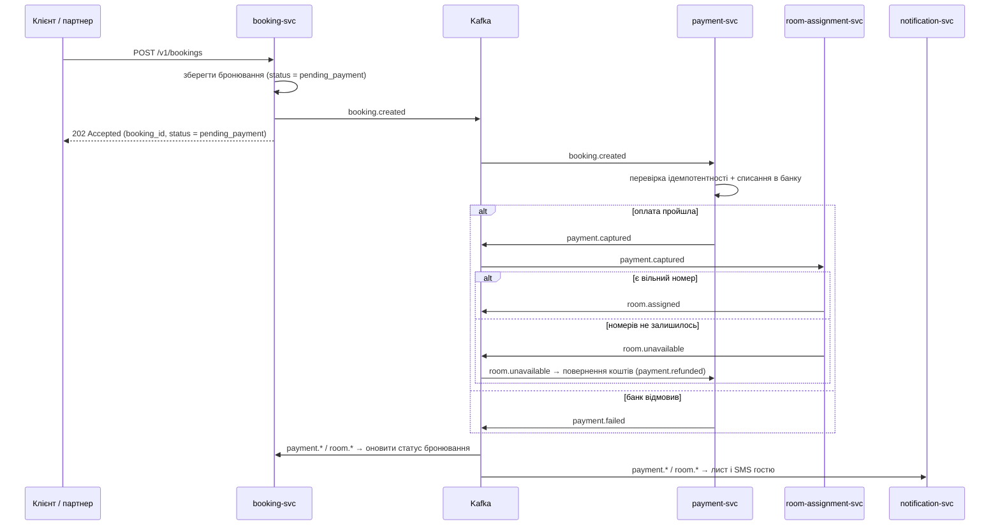

# Лабораторна робота №7. Синхронна та асинхронна комунікація: REST API, Kafka, ідемпотентність

Дисципліна: «Програмна інженерія (Software Engineering)»
Виконав: Бруско Максим, група МФ-51. **Варіант 1** — мережа готелів: публічний API бронювання номерів (`booking → payment → room-assignment`), 11-хвилинний збій платіжного сервісу.

Робота — це насамперед дизайн (відповіді нижче). Щоб перевірити висновки Завдань 3–4, додано невелику модель на Python (без сторонніх бібліотек):

```
python simulate_outage.py   # 11-хвилинний збій payment-svc: синхронна vs асинхронна версія
python test_simulation.py   # тести моделі
```

```
lab7/
├── simulation/event_log.py   # модель Kafka: топік-журнал, consumer group, offset, lag
├── simulation/services.py    # PaymentService (ідемпотентний), RoomAssignmentService, Bank
├── simulate_outage.py        # сценарій збою
├── test_simulation.py
└── results/simulate_outage.txt
```

## Завдання 1. Синхронний API бронювання

### Вибір: REST (JSON поверх HTTPS)

- **Сторонні партнери, яких ми не контролюємо** (агрегатори бронювань, туристичні сайти), пишуть на різних мовах і фреймворках. HTTP + JSON вміє будь-яка мова «з коробки», і викликати API можна навіть через `curl`. gRPC вимагає згенерувати клієнт із `.proto` і підтримувати HTTP/2. Для партнера це додатковий поріг входу.
- **Мобільний застосунок** спокійно працює з REST. gRPC у браузері і частині мобільних мереж/проксі потребує gRPC-Web і окремого шлюзу.
- **Кешування й інфраструктура.** `GET`-запити (бронювання, список бронювань) можна кешувати стандартними HTTP-механізмами (`ETag`, `Cache-Control`). Також працюють звичайні API-gateway, WAF, логування.
- **Документація.** OpenAPI (Swagger) — стандарт для публічних API. Партнер читає її і пробує запити без нашої участі.
- Мінуси REST — більший розмір повідомлень і немає строгого контракту «з коробки». Для бронювань (одиниці запитів на секунду від партнера) це не критично, а контракт описується через OpenAPI. gRPC я б залишив для внутрішніх викликів між сервісами, якщо там знадобиться швидкість.

### Ендпоінти

Усі запити — з `Authorization: Bearer <token>`. Помилки — у форматі RFC 7807 (`application/problem+json`).

| # | Метод і шлях | Що робить | Успіх | Помилки |
|---|---|---|---|---|
| 1 | `POST /v1/bookings` | створити бронювання (з оплатою) | **201 Created** + `Location` | **422** — невалідні дані (дата виїзду раніше заїзду, 0 гостей); **409** — номер цього типу на ці дати вже зайнятий; **402** — банк відхилив оплату; **503** — платіжний сервіс недоступний |
| 2 | `GET /v1/bookings/{booking_id}` | отримати бронювання | **200 OK** | **404** — не знайдено; **403** — бронювання іншого користувача/партнера |
| 3 | `GET /v1/users/{user_id}/bookings?limit=20&cursor=...&status=confirmed` | список бронювань користувача з пагінацією | **200 OK** | **400** — `limit` поза межами 1–100 або битий `cursor`; **403** — чужий користувач |
| 4 | `POST /v1/bookings/{booking_id}/cancel` | скасувати бронювання | **200 OK** | **404** — не знайдено; **409** — уже скасоване або гість уже заселився |
| 5 | `PATCH /v1/bookings/{booking_id}/stay-status` | оновити статус проживання (аналог статусу доставки): `room_assigned → checked_in → checked_out` | **200 OK** | **409** — недопустимий перехід (наприклад, `checked_out` до `checked_in`); **422** — невідомий статус; **404** — не знайдено |

Деталі:
- **`POST /v1/bookings` вимагає заголовок `Idempotency-Key`** (UUID від клієнта). Якщо мобільний застосунок не отримав відповідь через погану мережу і повторив запит, сервер поверне те саме бронювання, а не створить друге і не спише гроші двічі.
- **Скасування — `POST .../cancel`, а не `DELETE`.** Бронювання не видаляється: воно переходить у стан `cancelled`, а ще з'являється повернення коштів. `DELETE` означав би, що ресурсу більше немає.
- **Пагінація — курсорна** (`cursor` = закодований `created_at` + `id` останнього елемента), а не `page=N`. Нові бронювання не зсувають сторінки, і запит не сповільнюється на далеких сторінках.

### Структура відповідей

**`POST /v1/bookings`** — запит:

```json
{
  "hotel_id": "hotel-7",
  "room_type": "double",
  "check_in": "2026-12-01",
  "check_out": "2026-12-03",
  "guests": 2,
  "guest": { "name": "Maksym B.", "email": "guest@example.com", "phone": "+380501234567" },
  "payment_method_token": "pm_tok_9f8a"
}
```

Відповідь **201 Created**, `Location: /v1/bookings/bk_01HZX3`:

```json
{
  "booking_id": "bk_01HZX3",
  "status": "confirmed",
  "hotel_id": "hotel-7",
  "room_type": "double",
  "room_number": null,
  "check_in": "2026-12-01",
  "check_out": "2026-12-03",
  "nights": 2,
  "total": { "amount": "4500.00", "currency": "UAH" },
  "payment": { "status": "captured", "charge_id": "ch_7781" },
  "created_at": "2026-11-22T09:15:04Z",
  "links": { "self": "/v1/bookings/bk_01HZX3", "cancel": "/v1/bookings/bk_01HZX3/cancel" }
}
```

Типи: `booking_id`, `hotel_id`, `room_type`, `status` — `string`; `room_number` — `string | null` (номер призначається пізніше); `check_in`, `check_out` — `string` (ISO 8601 date); `nights`, `guests` — `integer`; `total.amount` — `string` (decimal: гроші не зберігаємо у float); `total.currency` — `string` (ISO 4217); `created_at` — `string` (ISO 8601 datetime, UTC).

**`GET /v1/users/{user_id}/bookings?limit=2`** — відповідь **200 OK**:

```json
{
  "items": [
    { "booking_id": "bk_01HZX3", "status": "confirmed", "hotel_id": "hotel-7",
      "check_in": "2026-12-01", "check_out": "2026-12-03",
      "total": { "amount": "4500.00", "currency": "UAH" } },
    { "booking_id": "bk_01HZ9K", "status": "checked_out", "hotel_id": "hotel-2",
      "check_in": "2026-10-10", "check_out": "2026-10-12",
      "total": { "amount": "3100.00", "currency": "UAH" } }
  ],
  "page": { "limit": 2, "next_cursor": "eyJjIjoiMjAyNi0xMC0wOCIsImlkIjoiYmtfMDFIWjlLIn0", "has_more": true }
}
```

`items` — масив скорочених бронювань (ті самі типи полів); `page.next_cursor` — `string | null` (`null`, коли сторінок більше немає); `page.has_more` — `boolean`.

**Помилка 409** при `POST /v1/bookings`:

```json
{
  "type": "https://api.hotels.example/errors/room-unavailable",
  "title": "Room type is not available for these dates",
  "status": 409,
  "detail": "No 'double' rooms left in hotel-7 for 2026-12-01..2026-12-03",
  "instance": "/v1/bookings"
}
```

### Версіонування: у URL (`/v1/...`)

- **Партнери не під нашим контролем.** Ми не можемо змусити їх оновити код у наш термін. Тому стара версія має жити паралельно з новою, і має бути однозначно видно, хто яку викликає.
- **Версія в URL видна всюди**: у документації, логах, метриках API-gateway, у прикладі `curl`. Партнер не може «забути» заголовок і випадково потрапити на нову версію з іншою схемою.
- **Маршрутизація проста**: gateway направляє `/v1/*` і `/v2/*` на різні розгортання.
- Версія заголовком (`Accept: application/vnd.hotels.v2+json`) «чистіша» з погляду REST, але її легко пропустити, вона гірше кешується і її складніше тестувати для сторонніх розробників.
- **Правила:**
  - мажорна версія (`v2`) — лише для несумісних змін (перейменування/видалення поля, зміна сенсу статусу);
  - додавання нових необов'язкових полів — без нової версії, клієнти мають ігнорувати невідомі поля;
  - про виведення старої версії попереджаємо заголовками `Deprecation` і `Sunset: <дата>` щонайменше за 6 місяців.

## Завдання 2. Асинхронна, подієво-орієнтована версія

### Послідовність подій



Текстом:
1. `booking-svc` → **`booking.created`** (топік `bookings`).
2. `payment-svc` читає `booking.created` → **`payment.captured`** або **`payment.failed`** (топік `payments`).
3. `room-assignment-svc` читає `payment.captured` → **`room.assigned`** або **`room.unavailable`** (топік `rooms`). Це аналоги `inventory.reserved` / `inventory.out_of_stock`.
4. На `room.unavailable` `payment-svc` робить повернення → `payment.refunded`.
5. `booking-svc` слухає всі три топіки й оновлює статус бронювання. `notification-svc` (Observer з Лабораторної №2) надсилає гостю лист/SMS.

Клієнт дізнається результат через `GET /v1/bookings/{id}` (статус `pending_payment → confirmed → room_assigned`) або через webhook для партнерів.

### Вибір: Event Streaming (Kafka)

| Властивість | Kafka | Чому це важливо для бронювань |
|---|---|---|
| **Retention** | подія зберігається заданий час (наприклад, 7 днів) **незалежно від того, чи її прочитали** | 11 хвилин збою — дрібниця: події лежать у журналі, поки payment-svc не повернеться |
| **Consumer groups** | кожна група має **власний offset** у тому самому топіку | `booking.created` потрібна платежам, аналітиці, стрічці «що бронювали друзі» (Лаба 6), антифроду. Кожен читає у своєму темпі, і новий споживач не вимагає змін у booking-svc |
| **Replay** | можна перечитати топік з будь-якого offset | Якщо payment-svc мав баг і неправильно обробив події за годину, після виправлення перечитуємо цей відрізок. Також це журнал аудиту: всі зміни бронювання записані по порядку |
| **Порядок** | гарантований у межах партиції | Ключ повідомлення = `booking_id`: усі події одного бронювання йдуть по порядку (`created → captured → assigned → cancelled`) |

RabbitMQ — це черга: повідомлення видаляється після підтвердження (`ack`). Щоб кілька сервісів отримали ту саму подію, треба налаштувати fanout exchange і окрему чергу для кожного. Перечитати вже оброблені повідомлення неможливо. Його сильні сторони — гнучка маршрутизація, пріоритети, відкладені повідомлення, підтвердження кожного повідомлення окремо. Для одного споживача-обробника задач це добре. Але в нас події мають жити довше за їх обробку і читатися багатьма незалежними сервісами. Тому Kafka.

### Схема події `payment.captured`

```json
{
  "event_id": "8b3f6c2e-4f1a-4c9e-9a51-0d2e7b1c5a77",
  "event_type": "payment.captured",
  "schema_version": 1,
  "occurred_at": "2026-11-22T09:15:06.412Z",
  "producer": "payment-svc",
  "correlation_id": "bk_01HZX3",
  "data": {
    "booking_id": "bk_01HZX3",
    "payment_id": "pay_5521",
    "charge_id": "ch_7781",
    "amount": "4500.00",
    "currency": "UAH",
    "method": "card",
    "captured_at": "2026-11-22T09:15:06.100Z"
  }
}
```

| Поле | Тип | Призначення |
|---|---|---|
| `event_id` | UUID | унікальний id події — для дедуплікації у споживачів |
| `event_type` | string | тип події, за ним споживач обирає обробник |
| `schema_version` | int | версія схеми — для еволюції без поломки старих споживачів |
| `occurred_at` | ISO 8601 datetime, UTC | коли подія сталася |
| `producer` | string | хто опублікував |
| `correlation_id` | string | зв'язує всі події одного бронювання (трасування, Лаба 11) |
| `data.booking_id` | string | **ключ партиції Kafka** |
| `data.amount` | string (decimal) | сума без похибок float |
| `data.currency` | string, ISO 4217 | валюта |
| `data.charge_id` | string | id списання в банку — потрібен для повернення |

Для `booking.created` `data` містить `booking_id`, `hotel_id`, `room_type`, `check_in`, `check_out`, `guests`, `amount`, `currency`, `payment_method_token`.

## Завдання 3. Поведінка при 11-хвилинному збої payment-svc

**Що з подіями `booking.created` за ці 11 хвилин? Не втрачаються.**
- `booking-svc` не залежить від payment-svc: він зберігає бронювання зі статусом `pending_payment`, публікує подію в Kafka і відповідає клієнту `202 Accepted`.
- Події накопичуються в топіку `bookings`. Їх зберігає retention (7 днів), а не те, чи їх хтось прочитав.
- Offset групи `payment-svc` стоїть на місці, **consumer lag** зростає. Це метрика для алерту (Лаба 11): «lag > 50 протягом 2 хвилин → черговому інженеру».
- `room-assignment-svc` і `notification-svc` працюють, просто в цей час не отримують нових `payment.captured`.

**Що одразу після відновлення?**
- payment-svc читає закомічений offset групи і продовжує **рівно з того місця**, де зупинився. Він обробляє накопичені події по порядку в межах кожного бронювання і поступово доводить lag до нуля.
- Далі ланцюжок іде як завжди: `payment.captured → room.assigned → лист гостю`. Гість отримує підтвердження із запізненням на кілька хвилин.
- Можливий сплеск навантаження на банк (сотні списань за хвилину). Його згладжує обмеження швидкості споживання (`max.poll.records`, rate limit), а при потребі — тимчасове збільшення кількості екземплярів payment-svc (до кількості партицій).
- Остання подія перед падінням могла бути оброблена, але не закомічена. Її буде доставлено вдруге — див. Завдання 4.

**Порівняння із синхронною версією** — для гостя, що саме зараз оформлює бронювання:

| | Синхронна версія (легенда, Завдання 1) | Асинхронна версія |
|---|---|---|
| Відповідь на `POST /v1/bookings` | чекає 30 с тайм-аут, потім **503 Service Unavailable** | одразу **202 Accepted**, `status: pending_payment` |
| Що бачить гість | помилку «спробуйте пізніше». Номер не утримано, гість іде до конкурента | «Бронювання прийнято, підтвердження надійде на пошту» |
| Чи збережено бронювання | ні, втрачено | так, у базі і в журналі Kafka |
| Коли гість дізнається результат | ніколи, якщо не повторить | через кілька хвилин після відновлення: лист або зміна статусу |
| Навантаження на booking-svc | потоки зависають на очікуванні, падіння поширюється каскадом | booking-svc не помічає збою |

Модель (`python simulate_outage.py`) — 3 бронювання на хвилину, 30 хвилин, payment-svc недоступний у хвилини 10–20:

```
=== Синхронна версія (booking-svc чекає payment-svc) ===
бронювань спробували: 90, підтверджено: 57, відмов 503: 33, списань: 57

=== Асинхронна версія (Kafka-подібний журнал) ===
хв 10: payment-svc DOWN оброблено  0, lag після = 3
хв 20: payment-svc DOWN оброблено  0, lag після = 33
хв 21: payment-svc відновився, lag = 36
хв 21: payment-svc UP   оброблено 36, lag після = 0
booking.created: 91, payment.captured: 91, room.assigned: 91, списань у банку: 91
максимальний lag: 33, lag у кінці: 0
подія bk-dup доставлена двічі, списань за нею: 1
```

Синхронна версія втратила 33 бронювання (11 хв × 3). Асинхронна не втратила жодного: lag виріс до 33 і за одну хвилину після відновлення впав до 0. (91-ша подія — окремий тест повторної доставки.)

Чесний мінус асинхронності: гість не отримує остаточного «так» одразу. Якщо банк потім відмовить, бронювання доведеться скасувати й повідомити гостя. Тому в інтерфейсі має бути статус «очікує оплати».

## Завдання 4. Гарантія доставки та ідемпотентність

**Гарантія Kafka за замовчуванням для нашого сценарію — at-least-once.**
- Продюсер: `acks=all` і повтори відправлення (з Kafka 3.0 за замовчуванням увімкнено `enable.idempotence=true`). Подія не губиться, і дублікати від повторів продюсера брокер відкидає.
- Споживач: payment-svc комітить offset **після** обробки події. Якщо він упав між «списав гроші» і «закомітив offset», після рестарту він знову отримає ту саму подію. Тобто подія буде оброблена щонайменше один раз, а іноді двічі.
- Якщо комітити offset **до** обробки — це at-most-once: падіння після коміту, але до списання, означає втрачений платіж. Для грошей це гірше.
- **Exactly-once** у Kafka (транзакції, `isolation.level=read_committed`) працює лише в межах Kafka: «прочитав з топіка → записав у топік». Списання в зовнішньому банку не входить у цю транзакцію. Тому для побічних ефектів назовні реалістичні лише at-least-once + ідемпотентний споживач.

**Механізм захисту від подвійного списання — ідемпотентний споживач, два рівні:**

1. **Таблиця оброблених платежів з унікальним ключем.** У базі payment-svc:

   ```sql
   CREATE TABLE payments (
       booking_id  TEXT PRIMARY KEY,          -- одна оплата на одне бронювання
       event_id    UUID NOT NULL UNIQUE,
       status      TEXT NOT NULL,             -- processing / captured / failed
       charge_id   TEXT,
       created_at  TIMESTAMPTZ NOT NULL DEFAULT now()
   );
   ```

   Обробка `booking.created`:
   - `INSERT INTO payments (booking_id, event_id, status) VALUES (..., 'processing') ON CONFLICT (booking_id) DO NOTHING`;
   - вставилось 0 рядків → подія вже оброблялась: банк не викликаємо, лише повторно публікуємо збережений результат і комітимо offset;
   - вставився рядок → списуємо гроші, оновлюємо `status = 'captured'`, `charge_id`, публікуємо `payment.captured`.

2. **Ключ ідемпотентності в банку.** Запит до процесингу передає `Idempotency-Key: <booking_id>` (так працюють Stripe, Adyen та ін.). Якщо payment-svc упав після відправлення запиту в банк, але до запису `captured` у свою таблицю, повторний запит з тим самим ключем поверне **той самий** `charge_id`, а не створить нове списання.

Ключ — саме `booking_id`, а не `event_id`. Навіть якщо booking-svc помилково опублікує дві різні події для одного бронювання, гроші спишуться один раз.

У моделі це перевіряє `test_duplicate_delivery_does_not_double_charge`: payment-svc «падає» після списання до commit offset, подія приходить удруге, а в банку одне списання і одна подія `payment.captured`.

## AI Usage — декларування використання ШІ

[ ] Під час виконання цієї лабораторної роботи інструменти генеративного ШІ НЕ використовувалися.

[X] Під час виконання цієї лабораторної роботи використовувалися інструменти ШІ як допоміжний засіб.

| Інструмент ШІ | Промпт / задача, делегована ШІ |
|---|---|
| Claude (Anthropic) | 1. Надіслано PDF умови лабораторної №7, варіант 1. 2. «Давай рухатися далі до 14 лаби» — ШІ спроєктував REST API, подієву схему на Kafka, описав поведінку при збої та ідемпотентність, написав модель для перевірки висновків і README. 3. «Зроби шпаргалку до захисту в репозиторії для кожної лаби» — ШІ підготував `cheatsheets/lab7.md`. |
