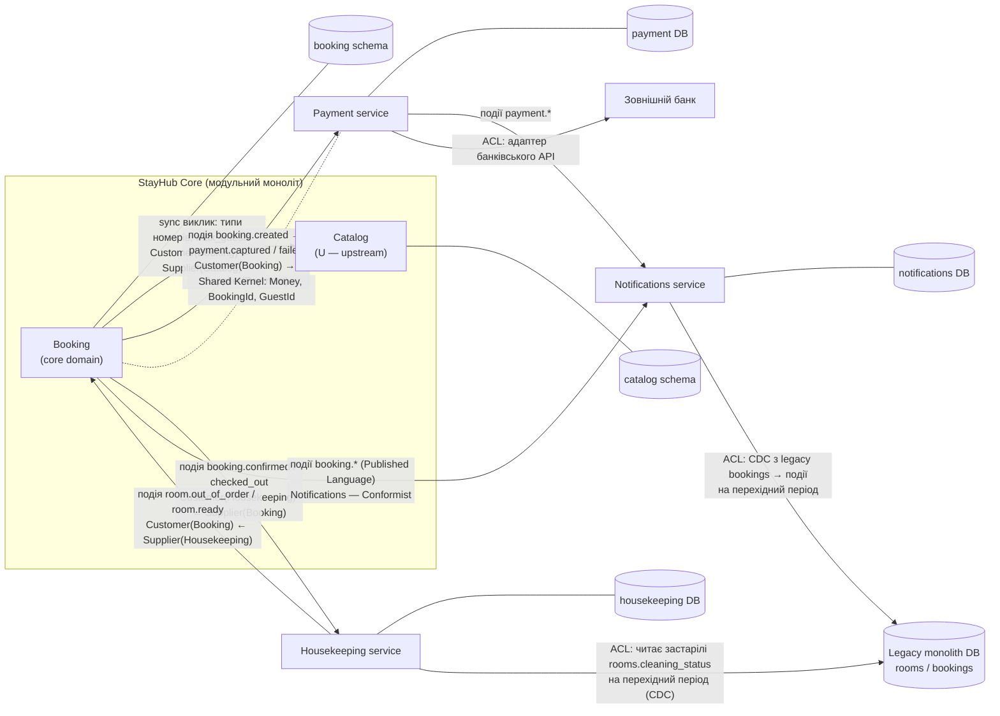
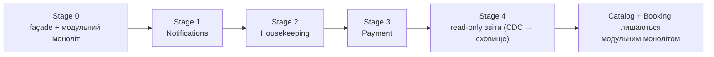

# Лабораторна робота №8. Bounded Contexts, карта контекстів і міграція Strangler Fig

Дисципліна: «Програмна інженерія (Software Engineering)»
Виконав: Бруско Максим, група МФ-51. **Варіант 1** — монолітний застосунок мережі готелів **«StayHub»**: спільні таблиці `rooms` / `bookings` і клас `BookingService`, що змішує відповідальності команд Catalog, Booking, Payment, Housekeeping і Notifications.

Робота — документ із чотирьох розділів. Діаграми — Mermaid (GitHub показує їх як картинки).

## Вхідні дані варіанта 1

За зразком легенди (TechBazaar) — схема і код StayHub. Коментар біля кожної колонки — команда, якій вона насправді потрібна.

```sql
-- монолітна схема StayHub (спрощено)
CREATE TABLE rooms (
    id                BIGINT PRIMARY KEY,
    hotel_id          BIGINT,
    room_number       VARCHAR(10),       -- Housekeeping (фізичні двері)
    room_type         VARCHAR(50),       -- Catalog + Booking
    title             VARCHAR(255),      -- Catalog
    description       TEXT,              -- Catalog
    photos_url        TEXT,              -- Catalog
    amenities         TEXT,              -- Catalog
    max_guests        INT,               -- Catalog + Booking
    base_price_uah    NUMERIC,           -- Booking (тарифи)
    floor             INT,               -- Housekeeping
    cleaning_status   VARCHAR(20),       -- Housekeeping: clean / dirty / inspected / out_of_order
    last_cleaned_at   TIMESTAMP,         -- Housekeeping
    maintenance_note  TEXT               -- Housekeeping
);

CREATE TABLE bookings (
    id                      BIGINT PRIMARY KEY,
    guest_id                BIGINT,
    room_id                 BIGINT,
    check_in                DATE,
    check_out               DATE,
    status                  VARCHAR(50),
    total_uah               NUMERIC,
    payment_transaction_id  VARCHAR(100), -- Payment
    card_last4              VARCHAR(4),   -- Payment
    refund_status           VARCHAR(20),  -- Payment
    cleaning_task_id        BIGINT,       -- Housekeeping
    last_notification_sent  VARCHAR(50)   -- Notifications
);
```

```python
class BookingService:
    def place_booking(self, guest, room_id, check_in, check_out, card):
        room = self.db.get_room(room_id)                                  # 1
        if room.cleaning_status == "out_of_order":                        # 2  Housekeeping
            raise RoomUnavailable(room_id)                                # 3  Housekeeping
        if self.db.has_overlap(room_id, check_in, check_out):             # 4  Booking
            raise RoomUnavailable(room_id)                                # 5  Booking
        nights = (check_out - check_in).days                              # 6  Booking
        total = room.base_price_uah * nights                              # 7  Booking (тариф)
        if nights >= 7:                                                   # 8  Booking (тариф)
            total *= LONG_STAY_DISCOUNT                                   # 9  Booking (тариф)
        txn = self.payment_gateway.charge(card, total)                    # 10 Payment
        booking = self.db.create_booking(guest, room_id, check_in,        # 11 Booking + Payment
                                         check_out, total, txn.id, card.last4)
        self.db.create_cleaning_task(room_id, due=check_out)              # 12 Housekeeping
        self.email_client.send(guest.email, "Booking confirmed")          # 13 Notifications
        return booking
```

## Завдання 1. Bounded Contexts

Виділено **п'ять** контекстів. Межу кожного я проводив не за таблицями, а за трьома ознаками:
- **власна мова** — ті самі слова означають інше;
- **власні інваріанти** — правила, які мають бути істинними всередині моделі;
- **власна причина змін** — хто і чому приходить правити код.

### 1. Catalog — «що ми продаємо»

| Колонки | Рядки `place_booking` |
|---|---|
| `rooms.room_type`, `title`, `description`, `photos_url`, `amenities`, `max_guests` | жодного: `place_booking` лише читає `room_type`/`max_guests` (рядок 1) |

**Чому окремий контекст.**
- Це маркетингова модель: як номер виглядає для гостя на сайті і в партнерів (тексти, фото, зручності, переклади).
- Змінюють її контент-менеджери і маркетинг, а не через бізнес-правила бронювання. Нове фото чи опис англійською не повинні вимагати міграції таблиці, з якою працює оплата.
- Інваріанти свої: у кожного типу номера є хоча б одне фото й опис кожною мовою сайту.
- Профіль навантаження — майже лише читання, легко кешується (Лаба 6).
- Одиниця моделі — **тип номера** («Deluxe Double, вид на море»), а не конкретні двері.

### 2. Booking — «хто, коли і за скільки живе»

| Колонки | Рядки `place_booking` |
|---|---|
| `bookings.id`, `guest_id`, `room_id`, `check_in`, `check_out`, `status`, `total_uah`; `rooms.base_price_uah` | 4–9 (перевірка перетину дат, ночі, тариф і знижка за довге проживання), частина рядка 11 (створення бронювання) |

**Чому окремий контекст.**
- Це ядро бізнесу (core domain), і в нього головний інваріант системи: **один номер на одні дати — лише одне бронювання**.
- Сюди ж належать тарифи і знижки. Ціна ночі — це рішення про продаж (revenue management), а не опис номера, тому `base_price_uah` переходить сюди, а не в Catalog.
- Мова: «бронювання», «ніч», «заїзд/виїзд», «доступність», «тариф», «скасування».
- Змінюється, коли змінюються правила продажу: нові тарифи, політика скасування, овербукінг.

### 3. Payment — «гроші»

| Колонки | Рядки `place_booking` |
|---|---|
| `bookings.payment_transaction_id`, `card_last4`, `refund_status` | 10 (списання), частина рядка 11 (`txn.id`, `card.last4`) |

**Чому окремий контекст.**
- Payment нічого не знає про номери і дати. Його мова — «списання», «транзакція», «повернення», «чарджбек», «сума у валюті».
- Інваріанти свої: сума повернень не більша за суму списання; одна оплата на одне бронювання (ідемпотентність, Лаба 7).
- Особливі вимоги: PCI DSS, аудит, окремий доступ до даних карток, інтеграція зі змінним зовнішнім банком.
- Ті самі операції потрібні й іншим продажам (ресторан готелю, SPA), тому модель не повинна залежати від бронювання номерів.

### 4. Housekeeping — «фізичний стан номерів»

| Колонки | Рядки `place_booking` |
|---|---|
| `rooms.room_number`, `floor`, `cleaning_status`, `last_cleaned_at`, `maintenance_note`; `bookings.cleaning_task_id` | 2–3 (номер виведено з експлуатації), 12 (створення завдання на прибирання) |

**Чому окремий контекст.**
- Це операційна модель для покоївок, супервайзерів і техніків. Одиниця — **конкретні двері 305 на 3-му поверсі**.
- Мова: «брудний / прибраний / перевірений / не в експлуатації», «завдання на прибирання», «зміна», «заміна білизни».
- Інваріант свій: номер не можна віддати гостю, поки він не в стані `inspected`.
- Інший профіль роботи: мобільний застосунок на планшетах, пік з 11:00 до 14:00 (виїзд/заїзд), потрібна робота при поганому Wi-Fi.
- Окрема команда з власним темпом змін.

### 5. Notifications — «повідомити людей»

| Колонки | Рядки `place_booking` |
|---|---|
| `bookings.last_notification_sent` | 13 (лист «Booking confirmed») |

**Чому окремий контекст.**
- Мова: «шаблон», «канал» (email/SMS/push), «згода на розсилку», «доставлено / не доставлено», «повтор» (Лаба 2).
- Йому не потрібна бізнес-логіка бронювання. Він реагує на події інших контекстів і відповідає за доставку.
- Змінюється через маркетинг і канали (новий шаблон, Telegram), а не через правила бронювання.
- Колонка `last_notification_sent` у таблиці бронювань — класичний приклад «чужої» колонки: бронюванню вона не потрібна.

### Одне слово — різні значення: «Room» (номер)

| Контекст | Що означає «номер» |
|---|---|
| **Catalog** | **тип номера як товар**: «Deluxe Double з видом на море, 28 м², до 2 гостей, 12 фото». Таких дверей може бути 40, для каталогу це один запис |
| **Booking** | **одиниця доступності на конкретні ночі**: «вільна ніч у Double на 1 грудня». Гість бронює тип, а конкретні двері часто призначаються ближче до заїзду |
| **Housekeeping** | **фізичні двері 305 на 3-му поверсі** з поточним станом: брудний, прибраний, зламаний кондиціонер |
| **Payment** | поняття «номер» **не існує**: є сума, валюта і посилання на бронювання |

Через змішування в одній таблиці `rooms` один рядок одночасно є і «товаром», і «дверима», тож `cleaning_status` конкретних дверей опиняється поруч із маркетинговим описом типу.

Схоже з **`status`**: у `bookings.status` (confirmed/cancelled), `rooms.cleaning_status` і `refund_status` — три різні життєві цикли, які в моноліті легко сплутати.

## Завдання 2. Карта контекстів



По кожній стрілці:

| Від → до | Взаємодія | DDD-патерн | Хто клієнт, хто постачальник |
|---|---|---|---|
| Booking → Catalog | синхронний виклик (дані типів номерів, `max_guests`) + кеш | **Customer-Supplier** | **клієнт — Booking**, постачальник — Catalog. Catalog погоджує з Booking зміни контракту |
| Booking → Payment | подія `booking.created`, у відповідь `payment.captured` / `payment.failed` (Лаба 7) | **Customer-Supplier** | **клієнт — Booking** (ініціює оплату), постачальник — Payment |
| Booking ↔ Payment | спільна бібліотека значень `Money`, `BookingId`, `GuestId` | **Shared Kernel** (малий, змінюється лише за згодою обох команд) | — |
| Booking → Housekeeping | події `booking.confirmed`, `booking.checked_out` → завдання на прибирання | **Customer-Supplier** | **клієнт — Housekeeping**, постачальник — Booking. Housekeeping просить потрібні поля в події |
| Housekeeping → Booking | події `room.out_of_order`, `room.ready` → Booking блокує/відкриває доступність | **Customer-Supplier** | **клієнт — Booking**, постачальник — Housekeeping |
| Booking, Payment → Notifications | події `booking.*`, `payment.*` | **Published Language + Conformist**: Notifications приймає схему подій як є | Notifications — споживач, на зміни схеми не впливає |
| Housekeeping → Legacy DB | CDC з таблиці `rooms` монолітної бази на перехідний період | **Anti-Corruption Layer** | ACL перекладає `cleaning_status = 'OOO'` і змішаний рядок `rooms` у чисту модель `PhysicalRoom(number, floor, state)` |
| Notifications → Legacy DB | CDC з таблиці `bookings` монолітної бази | **Anti-Corruption Layer** | ACL перетворює «змінився рядок bookings» на бізнес-подію `BookingConfirmed` |
| Payment → Bank | синхронний HTTP-виклик | **Anti-Corruption Layer** | модель банку (коди відповіді, власні статуси) не протікає в Payment |

Кожен контекст має свою базу. Catalog і Booking живуть в одному процесі (модульний моноліт, Завдання 4), але в **окремих схемах** PostgreSQL. Модуль Booking не читає таблиці Catalog напряму, лише через його публічний інтерфейс.

## Завдання 3. Поетапний план міграції (Strangler Fig)

Перед монолітом ставимо **routing façade** — API-gateway (nginx / Kong), через який проходять усі запити. На кожній стадії частина маршрутів перемикається на новий сервіс, решта йде в моноліт. Кожна стадія самостійно корисна, і її можна відкотити, повернувши маршрут на моноліт.



### Stage 0 — базовий моноліт за façade

- Ставимо façade, усі маршрути поки що йдуть у моноліт. Нічого не змінюється для користувачів, але з'являється точка перемикання.
- Усередині моноліту розносимо код `BookingService` по модулях п'яти контекстів (як у Лабораторних 1 і 3). Модулі звертаються один до одного лише через інтерфейси.
- Додаємо в моноліт **transactional outbox**: таблиця `outbox_events`, в яку бізнес-події записуються в тій самій транзакції, що й зміна даних.
- Переносу даних немає, тож синхронізація не потрібна.

### Stage 1 — Notifications

- Новий `notifications-svc` зі своєю базою (шаблони, згоди, журнал доставки).
- **Синхронізація: Change Data Capture.** Debezium читає WAL монолітної бази (таблиці `bookings`, `outbox_events`). ACL перетворює зміни рядків у події `booking.confirmed`, `booking.cancelled`.
- **Чому CDC.** Notifications лише читає чужі дані і нічого не пише в моноліт. Затримка в кілька секунд для листа нормальна. CDC не вимагає змін у коді моноліту і не може «зламати» бронювання. Ризик мінімальний: у найгіршому разі лист прийде пізніше або двічі.
- **Cutover.**
  - Кілька днів обидва надсилають листи на тестові адреси, і порівнюємо результати.
  - Потім прапорцем (feature flag) вимикаємо `email_client.send` у моноліті, і листи надсилає лише новий сервіс.
  - Колонку `last_notification_sent` перестаємо писати, через місяць видаляємо.
  - CDC-місток із `bookings` **вимикається на Stage 3–4**, коли Booking публікує події через outbox напряму. Тоді ACL на CDC стає непотрібним.

### Stage 2 — Housekeeping

- Новий `housekeeping-svc` зі своєю базою (`physical_rooms`, `cleaning_tasks`, `shifts`) і мобільним застосунком. Маршрути `/housekeeping/*` façade перемикає на новий сервіс.
- **Синхронізація: CDC в обидва боки на перехідний період.**
  - Монолітна база → Housekeeping (через ACL): нові бронювання і виїзди → завдання на прибирання; початкове завантаження поточних `cleaning_status`.
  - Housekeeping → монолітна база: після cutover власником стану номера стає Housekeeping. Моноліт поки що читає `rooms.cleaning_status` у `place_booking` (рядки 2–3), тому зворотний CDC-потік оновлює цю колонку.
- **Чому CDC, а не Dual Write.** Стан прибирання — операційні дані. Затримка в кілька секунд допустима: номер не прибирають за секунду. Dual Write з двох місць дав би розбіжності при частковому збої (запис в одну базу пройшов, в іншу ні), а виграшу не дав би.
- **Cutover.**
  - Застосунок покоївок переходить на новий сервіс, моноліт перестає писати колонки `floor`, `cleaning_status`, `last_cleaned_at`, `maintenance_note` (вони стають read-only).
  - **Прямий** CDC-потік (моноліт → Housekeeping) вимикаємо, коли Booking почне публікувати `booking.confirmed / checked_out` через outbox (кінець Stage 3).
  - **Зворотний** потік вимикаємо, коли модуль Booking перейде на подію `room.out_of_order` замість читання колонки. Після цього колонки видаляємо з `rooms`.

### Stage 3 — Payment

- Новий `payment-svc` з окремою базою в окремому, захищеному сегменті мережі (зона PCI DSS). Списання і повернення йдуть лише через нього (Лаба 7: подія `booking.created` → `payment.captured`).
- **Синхронізація: Dual Write з боку нового сервісу + щоденна звірка.**
  - `payment-svc` — єдиний, хто виконує списання. Свій запис він робить у власній базі в транзакції.
  - Одразу після цього він синхронно записує `payment_transaction_id`, `card_last4`, `refund_status` у моноліт через внутрішній API. Повтори йдуть через outbox, поки запис не пройде.
  - Щоночі job звіряє обидві бази за `transaction_id` і сигналізує про розбіжності.
- **Чому Dual Write, а не CDC.**
  - Для платежів важлива **відсутність затримки**. Адміністратор на рецепції відкриває бронювання одразу після оплати. Якщо через CDC-лаг він бачить «не оплачено», він може взяти оплату ще раз або відмовити гостю в заселенні.
  - Для аналітики (Stage 4) лаг у хвилини нічого не важить, а тут кожна розбіжність — це гроші й скарга.
  - Водночас Dual Write має відомий ризик часткового збою. Тому писати в обидва місця може лише **один** компонент (payment-svc), а не «і моноліт, і сервіс». Повтори йдуть через outbox, а звірка ловить те, що проскочило.
  - Перед cutover — **shadow mode**: кілька днів новий сервіс рахує суми паралельно з монолітом, але не списує гроші, і порівнюємо результати.
- **Cutover.**
  - façade перемикає `/payments/*` і крок оплати на `payment-svc`, у моноліті вимикаємо `payment_gateway.charge`.
  - Dual Write **вимикаємо**, коли екран повернень на рецепції і звіти бухгалтерії читають оплату через API `payment-svc`, а не з колонок `bookings`.
  - Колонки ще 30 днів лишаються read-only (для аудиту і відкату), потім видаляються. Дані карток (`card_last4`) зникають з монолітної бази, і моноліт виходить із зони PCI DSS.

### Stage 4 — read-only звіти

- Допоміжна стадія: звіти (завантаження готелів, виручка — як у Лабораторній 5) переносимо у сховище даних (окрема аналітична БД або Power BI). Важкі аналітичні запити більше не навантажують робочу базу.
- **Синхронізація: CDC** з усіх баз (моноліт, Payment, Housekeeping) у сховище.
- **Чому CDC.** Аналітика лише читає, затримка в хвилини прийнятна, а CDC не додає жодного навантаження на код сервісів.
- **Cutover**: звітні маршрути façade перемикає на новий звітний сервіс, старі SQL-звіти в моноліті видаляються. CDC тут не тимчасовий місток, а постійний механізм.

### Чому саме такий порядок

1. **Notifications першим** — найменший ризик: контекст лише читає, нічого не пише в чужі дані, помилка означає запізнілий лист. На ньому команда відпрацьовує façade, CDC, розгортання та моніторинг окремого сервісу.
2. **Housekeeping другим** — найбільша операційна цінність: окрема команда, інший профіль навантаження (планшети, пік 11:00–14:00), потреба в незалежних релізах мобільного застосунку. Ризик помірний: гроші не зачіпає.
3. **Payment третім** — найвищий ризик, тому коли інфраструктура (façade, outbox, моніторинг) уже перевірена на двох сервісах. Цінність теж висока: вихід моноліту із зони PCI DSS, незалежні релізи при змінах банку.
4. **Catalog і Booking не виносимо взагалі** — див. Завдання 4. Booking — серце системи з найсуворішим інваріантом. Переносити його найризиковіше, а користі від окремого процесу зараз немає.

## Завдання 4. Де зупинитись

Мій план зупиняється на трьох винесених сервісах (Notifications, Housekeeping, Payment), а Catalog і Booking лишаються **одним модульним монолітом** зі строгими межами модулів і окремими схемами БД.

Кожен винесений сервіс має щонайменше два реальні докази з лекції:
- **Housekeeping** — окрема команда, якій тісно в спільному коді, і кардинально інший профіль навантаження (мобільні клієнти, пік на виїзді/заїзді);
- **Payment** — реальна бізнес-потреба в незалежному релізі (зміни банку, вимоги PCI DSS) і окремий профіль безпеки;
- **Notifications** — інший профіль навантаження (масові розсилки, повтори, зовнішні провайдери) і незалежні релізи шаблонів і каналів.

Для Catalog і Booking жоден із доказів зараз не виконується:
- з ними працюють дві невеликі команди, що й так тісно співпрацюють;
- навантаження в обох — читання каталогу і доступності, і його вже знімає кеш (Лаба 6);
- релізи бронювання й каталогу і так зазвичай ідуть разом (новий тип номера — це і опис, і тариф).

**Операційний податок.** Кожен додатковий сервіс — це:
- ще **один CI/CD-пайплайн** (збірка, тести, розгортання, відкат);
- ще **одна on-call-ротація** або розширення наявної;
- щонайменше **чотири точки спостережуваності**: логи, метрики, трейси і SLO-алерти (Лаба 11);
- окрема база з бекапами і міграціями, мережеві виклики з тайм-аутами і повторами (Лаба 10).

Три винесені сервіси вже додають три пайплайни і три набори дашбордів. Розділення Catalog і Booking додало б ще два без помітної користі для бізнесу.

**Ризик розподіленого моноліту.** Якщо різати далі необачно — за технічним шаром, а не за бізнес-можливістю (наприклад, окремо `booking-api`, `pricing-calculator` і `availability-db-service`), — то одне бронювання вимагатиме синхронного ланцюжка з трьох мережевих викликів. Ці сервіси доведеться розгортати разом при кожній зміні правил бронювання. Збій будь-якого з них зупинить продаж. Отримаємо всі мінуси мікросервісів (мережа, затримки, складне налагодження) і жодного плюса (незалежні релізи). Тому межі мають іти за bounded contexts, а розділяти контекст повертаємось, лише коли з'явиться реальний доказ: команда Booking виросла до кількох команд або нам потрібен незалежний реліз тарифів.

## AI Usage — декларування використання ШІ

[ ] Під час виконання цієї лабораторної роботи інструменти генеративного ШІ НЕ використовувалися.

[X] Під час виконання цієї лабораторної роботи використовувалися інструменти ШІ як допоміжний засіб.

| Інструмент ШІ | Промпт / задача, делегована ШІ |
|---|---|
| Claude (Anthropic) | 1. Надіслано PDF умови лабораторної №8, варіант 1 (StayHub). 2. «Давай рухатися далі до 14 лаби» — ШІ склав схему і код моноліту StayHub за зразком легенди, виділив bounded contexts, намалював карту контекстів (Mermaid), спланував міграцію Strangler Fig і написав README. 3. «Зроби шпаргалку до захисту в репозиторії для кожної лаби» — ШІ підготував `cheatsheets/lab8.md`. |
