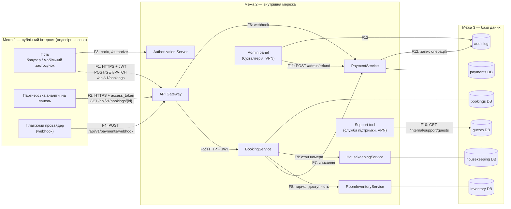
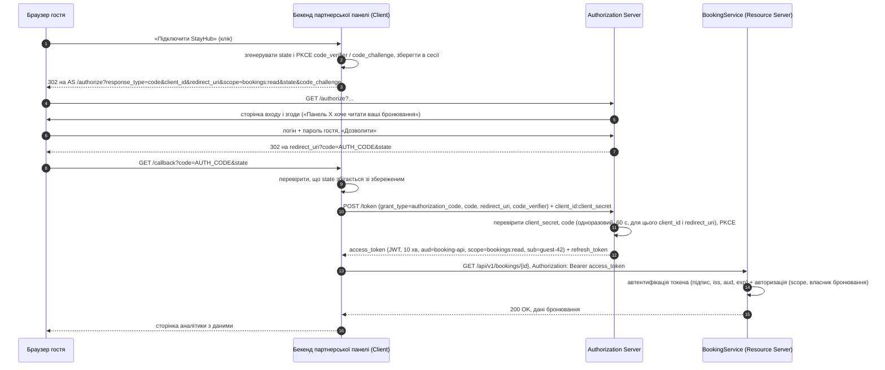

# Лабораторна робота №9. Threat Modeling (STRIDE), SQL-ін'єкція, OAuth 2.0 Authorization Code Flow

Дисципліна: «Програмна інженерія (Software Engineering)»
Виконав: Бруско Максим, група МФ-51. **Варіант 1** — мікросервісна система бронювання готелів: `API Gateway → BookingService → PaymentService / RoomInventoryService / HousekeepingService`, внутрішній пошук гостей за прізвищем, партнерська аналітична панель готельної мережі.

Код для Завдання 2 (і перевірки Resource Server із Завдання 3) — Python 3.10+, Flask, SQLite:

```
pip install -r requirements.txt
python support_app.py         # демонстрація ін'єкції: вразлива vs виправлена версія
pytest -q test_security.py    # 11 тестів
```

```
lab9/
├── guest_db.py               # тестова база гостей (SQLite у пам'яті)
├── support_app.py            # /internal/support/guests: вразлива і параметризована версії
├── resource_server.py        # перевірки access_token перед GET /v1/bookings/{id}
├── test_security.py
└── results/injection_demo.txt
```

## Система (вхідні дані варіанта 1)

Як у Лабораторних 7–8: API Gateway приймає запити з інтернету і маршрутизує їх до BookingService. Той під час бронювання викликає PaymentService (списання), RoomInventoryService (тариф і доступність номерів) і HousekeepingService (стан номера). У кожного сервісу своя база. Клієнти автентифікуються JWT (`Authorization: Bearer`).

```
POST   /api/v1/bookings                  -- створити бронювання
GET    /api/v1/bookings/{id}             -- переглянути бронювання
PATCH  /api/v1/bookings/{id}/cancel      -- скасувати бронювання
POST   /api/v1/payments/webhook          -- callback від платіжного провайдера
POST   /admin/refund                     -- внутрішній ендпоінт повернення коштів
GET    /internal/support/guests?last_name=...   -- пошук гостя службою підтримки
```

## Завдання 1. Threat modeling за STRIDE

### Data Flow Diagram з межами довіри



**Межі довіри:**
- **Межа 1 → 2** перетинається в API Gateway (F1, F2, F4) і в Authorization Server (F3). Тут ми нічому не віримо: ні тілу запиту, ні заголовкам, ні тому, що «це наш застосунок».
- **Межа 2 → 3** — доступ сервісів до своїх баз. Кожен сервіс має власного користувача БД з мінімальними правами.
- Support tool і Admin panel — у внутрішній мережі, але ними користуються люди. Тому для них діють окремі ролі та аудит, а не «довіра, бо всередині».

### Таблиця загроз

| Категорія | Елемент / стрілка | Загроза | Мітигація |
|---|---|---|---|
| **S** — Spoofing | F1 (гість → Gateway) | JWT гостя вкрадено (XSS, шкідливе розширення, лог проксі). Зловмисник видає себе за гостя, бачить і скасовує його бронювання. Це spoofing: атакують **справжність того, хто звертається** | access_token живе 10–15 хв, refresh_token ротується при кожному використанні (повторне використання старого → відкликання всієї сесії); на вебі токени в `HttpOnly; Secure; SameSite=Strict` cookie, а не в `localStorage`; CSP проти XSS |
| **S** — Spoofing | F4 (провайдер → `/api/v1/payments/webhook`) | Будь-хто з інтернету надсилає підроблений webhook «payment succeeded» для свого бронювання і живе безкоштовно. Атакують **справжність відправника** callback | перевірка HMAC-SHA256 підпису тіла (заголовок `Signature`, спільний секрет з провайдером) + мітка часу з вікном 5 хв проти повтору + перевірка `event_id` на унікальність; статус оплати додатково підтверджується запитом до API провайдера |
| **S** — Spoofing | F7 (Booking → Payment) | Зламаний під у внутрішній мережі викликає PaymentService «від імені» BookingService | mTLS між сервісами з ідентичностями (SPIFFE/service mesh). PaymentService приймає виклики списання лише від сертифіката `booking-svc` |
| **T** — Tampering | F1, `POST /api/v1/bookings` | Гість змінює в тілі запиту `"total": "1.00"` або `"room_type": "suite"` при ціні `standard`. Це tampering: **змінюються дані** в дорозі від клієнта | сервер ігнорує будь-яку ціну від клієнта: BookingService бере тариф з RoomInventoryService (F8) і сам рахує суму; JSON-схема запиту відкидає зайві поля (`additionalProperties: false`) |
| **T** — Tampering | F5 (Gateway → Booking) | Gateway після перевірки JWT передає `X-User-Id`. Зловмисник сам додає `X-User-Id: guest-7` у запит, і, якщо Gateway його не стирає, BookingService вірить підробленому заголовку | Gateway **видаляє** всі вхідні заголовки ідентичності (`X-User-*`) і ставить свої; BookingService перевіряє сам JWT (підпис, `aud`), а не довіряє заголовку; трафік F5–F9 — лише TLS |
| **R** — Repudiation | F11 (`POST /admin/refund`) | Співробітник бухгалтерії робить повернення 20 000 грн на «свою» картку, а потім каже: «Я цього не робив». Це repudiation: немає **доказу, хто виконав дію** | append-only журнал аудиту (F12): хто (`sub` з токена), коли, `booking_id`, сума, обов'язкова причина, IP. Записи з'єднані ланцюжком хешів (кожен містить хеш попереднього) і щогодини копіюються у WORM-сховище (S3 Object Lock). Правити журнал не може ніхто з команди |
| **R** — Repudiation | F1, `PATCH .../cancel` | Гість скасовує бронювання, після штрафу каже «я не скасовував» і відкриває чарджбек у банку | кожне скасування — подія `booking.cancelled` у Kafka (Лаба 7) з `sub`, `jti` токена, IP, User-Agent і часом; лист-підтвердження скасування гостю; дані зберігаються протягом строку чарджбеку (120 днів) |
| **I** — Information Disclosure | F2/F1, `GET /api/v1/bookings/{id}` | **IDOR**: id бронювань ідуть підряд (`1001`, `1002`…). Гість з дійсним токеном перебирає id і бачить імена, телефони і дати проживання чужих гостей. Це information disclosure: токен справжній, дія дозволена, але **витікають чужі дані** | перевірка власника в BookingService: `booking.guest_id == token.sub` (або партнер має scope на цей `hotel_id`), інакше 404 (не 403, щоб не підтверджувати існування); id — ULID/UUID, а не лічильник. Реалізовано в `resource_server.py` |
| **I** — Information Disclosure | F10 (`/internal/support/guests`) | SQL-ін'єкція в пошуку за прізвищем віддає email і телефони **всіх** гостей (Завдання 2). Навіть без ін'єкції ендпоінт віддає більше полів, ніж потрібно | параметризований запит; доступ лише з VPN з роллю `support`; телефон маскується (`+38050*****11`); rate limit 30 запитів/хв на співробітника; кожен пошук пишеться в аудит |
| **I** — Information Disclosure | Gateway → інтернет | Помилка 500 повертає stack trace з SQL-запитом, назвами таблиць і версіями бібліотек | глобальний обробник помилок: клієнту — лише `application/problem+json` з `trace_id`, деталі — тільки в лог |
| **D** — Denial of Service | F1, `POST /api/v1/bookings` | Бот створює тисячі бронювань зі статусом `pending_payment` на новорічні дати. Номери «утримуються», і справжні гості бачать «немає місць» (inventory hoarding). Це DoS: атакують **доступність** продажу | rate limit на Gateway (наприклад, 5 бронювань/хв на користувача і 20/хв на IP); не більше 3 активних `pending_payment` на гостя; `pending_payment` автоматично знімається через 15 хв без оплати; CAPTCHA після підозрілої активності |
| **D** — Denial of Service | F8 (Booking → RoomInventory) | Повільний RoomInventoryService «підвішує» всі потоки BookingService, і бронювання зупиняються повністю | тайм-аут 1–2 с, circuit breaker і bulkhead (окремий пул з'єднань на кожну залежність — Лаба 10); кеш доступності (Лаба 6) |
| **E** — Elevation of Privilege | F11 + Gateway, `POST /admin/refund` | `/admin/refund` доступний через публічний Gateway і перевіряє лише «токен дійсний», а не роль. Звичайний гість зі своїм JWT робить собі повернення коштів. Це elevation of privilege: **користувач отримує права адміністратора** | `/admin/*` взагалі не маршрутизується з публічного Gateway (лише з VPN/внутрішнього ingress); PaymentService перевіряє claim `roles` містить `refund_operator`; сума повернення ≤ сумі списання; повернення > 10 000 грн — лише після підтвердження другим співробітником (four-eyes) |
| **E** — Elevation of Privilege | F1/F2, перевірка JWT | Підробка токена: зловмисник ставить `"alg": "none"` або підписує HS256 публічним ключем і додає собі `"roles": ["admin"]` | бібліотека JWT з **фіксованим** списком алгоритмів (`algorithms=["RS256"]`), ключі лише з JWKS Authorization Server-а; ролі беруться з токена, виданого AS, і ніколи з тіла запиту |

**Чому саме ці категорії.** S — під сумнівом, **хто** надсилає запит. T — під сумнівом **цілісність даних**. R — **неможливо довести**, хто що зробив. I — дані бачить **той, кому не можна**. D — система **недоступна** для справжніх користувачів. E — хтось отримує **більше прав**, ніж має. Наприклад, IDOR — це I, а не E: гість лишається гостем з правом «читати бронювання», але бачить чужі дані. А відсутність перевірки ролі на `/admin/refund` — це E: гість фактично отримує роль бухгалтера.

## Завдання 2. SQL-ін'єкція в пошуку гостей

Вихідний код (варіант 1 — пошук гостя за прізвищем):

```python
@app.route("/internal/support/guests")
def search_guests():
    last_name = request.args.get("last_name")
    query = f"SELECT id, email, phone, loyalty_points FROM guests " \
            f"WHERE last_name = '{last_name}'"          # <-- рядки 4–5: ін'єкція
    rows = db.execute(query)
    return jsonify(rows)
```

**Де ін'єкція.** У рядках 4–5, де f-рядок вклеює `last_name` прямо в текст SQL. Користувацьке значення стає частиною SQL-коду, і СУБД не може відрізнити, де закінчились дані і почалась команда.

**Шкідливе значення**, що повертає всіх гостей:

```
last_name = ' OR '1'='1
```

Після підстановки запит стає таким:

```sql
SELECT id, email, phone, loyalty_points FROM guests WHERE last_name = '' OR '1'='1'
```

Умова `'1'='1'` істинна для кожного рядка, тож повертається вся таблиця. Перевірено (`python support_app.py`, `results/injection_demo.txt`):

```
/internal/support/guests-vulnerable?last_name="' OR '1'='1" -> 5 рядків: [[1, 'taras@example.com', ...], ..., [5, 'petro@example.com', ...]]
/internal/support/guests?last_name="' OR '1'='1" -> 0 рядків: []
/internal/support/guests?last_name="O'Brien" -> [[4, 'sean@example.com', '+353861234567', 900]]
```

Так само через `' UNION SELECT id, card_last4, ... FROM payments --` можна читати інші таблиці, якщо в користувача БД є до них доступ.

**Виправлена функція** (`support_app.py`):

```python
@app.route("/internal/support/guests")
def search_guests():
    last_name = request.args.get("last_name", "")
    if not last_name or len(last_name) > 100:
        return jsonify({"error": "last_name is required (1..100 chars)"}), 422
    rows = db.execute(
        "SELECT id, email, phone, loyalty_points FROM guests WHERE last_name = ?",
        (last_name,),                                   # значення передається окремо від SQL
    ).fetchall()
    return jsonify(rows)
```

Для PostgreSQL (psycopg2) — те саме з `%s`: `cursor.execute("... WHERE last_name = %s", (last_name,))`.

**Чому параметризація унеможливлює ін'єкцію на рівні механізму.** Текст запиту з плейсхолдером `?` і значення передаються в СУБД **окремо**. СУБД спочатку розбирає і компілює запит, коли значення ще немає, тому структуру запиту (які умови, які таблиці) вже зафіксовано. Потім значення підставляється як **один літерал** типу TEXT. Рядок `' OR '1'='1` — це просто дивне прізвище, яке ні з чим не збігається, а лапки в ньому ніколи не розбираються як SQL. Тест `test_parameterized_endpoint_returns_nothing_for_payload` це перевіряє. Бонус: справжнє прізвище `O'Brien` теж працює, а вразлива версія на ньому падає з помилкою синтаксису.

**Чому фільтрація підрядків недостатня.** Чорний список завжди неповний: є коментарі (`--`, `/* */`), інші лапки й кодування, числові контексти без лапок, `UNION`, `||`, особливості конкретної СУБД. До того ж фільтр ламає легітимні дані (`O'Brien`, `Orlova`, якщо видаляти `OR`), тоді як параметризація прибирає саму можливість змішати дані з кодом.

Додатково для цього ендпоінта: окремий користувач БД з правом лише `SELECT` на `guests` (ін'єкція не дістанеться до `payments`), доступ лише з роллю `support`, маскування телефону, аудит.

## Завдання 3. OAuth 2.0 Authorization Code Flow

Партнерська аналітична панель готельної мережі (Client) хоче читати `GET /api/v1/bookings/{id}` від імені конкретного гостя (Resource Owner), не знаючи його пароля.



Кроки текстом:
1. Гість у браузері натискає в панелі партнера «Підключити StayHub».
2. Бекенд панелі генерує випадковий `state` (проти CSRF) і пару PKCE `code_verifier` / `code_challenge`, зберігає їх у сесії.
3. Бекенд відповідає браузеру `302` на `https://auth.stayhub.example/authorize?response_type=code&client_id=partner-analytics&redirect_uri=https://partner.example/callback&scope=bookings:read&state=...&code_challenge=...&code_challenge_method=S256`.
4. Браузер відкриває `/authorize` на Authorization Server.
5. AS показує форму входу і екран згоди.
6. Гість вводить логін і пароль **на сторінці AS** (партнер пароля не бачить) і натискає «Дозволити».
7. AS перенаправляє браузер на `redirect_uri?code=AUTH_CODE&state=...`.
8. Браузер передає `code` і `state` бекенду панелі (`GET /callback`).
9. Бекенд перевіряє, що `state` збігається зі збереженим у сесії.
10. **Тут у обмін вступає `client_secret`.** Бекенд панелі напряму (server-to-server, TLS) викликає `POST /token` на AS: `grant_type=authorization_code`, `code`, `redirect_uri`, `code_verifier`, а `client_id` і `client_secret` — у заголовку `Authorization: Basic`.
11. AS перевіряє `client_secret`, що `code` одноразовий, не прострочений (60 с) і виданий саме цьому `client_id` і `redirect_uri`, і що `SHA256(code_verifier) == code_challenge`.
12. AS повертає `access_token` (JWT: `iss`, `aud=booking-api`, `sub=guest-42`, `scope=bookings:read`, `exp` через 10 хв) і `refresh_token`. Токени зберігаються лише на бекенді панелі.
13. Бекенд панелі викликає `GET /api/v1/bookings/{id}` з `Authorization: Bearer <access_token>`.
14. BookingService перевіряє токен (див. нижче).
15. BookingService повертає `200 OK` з даними бронювання.
16. Панель показує гостю аналітику.

**Чому `client_secret` — лише між бекендом Client-а і Authorization Server.** Усе, що проходить через браузер (URL редиректів, історія, `Referer`, розширення, логи проксі), фактично публічне, тож секрет у браузері знав би будь-хто і міг видавати себе за партнерську панель. Тому браузер переносить лише короткоживучий одноразовий `code`, а обміняти його на токен може тільки той, хто знає `client_secret` (і `code_verifier` PKCE), — бекенд партнера через пряме TLS-з'єднання. Перехоплений у браузері `code` без секрету нічого не дає.

**Що Resource Server перевіряє над `access_token`** (`resource_server.py`, тести в `test_security.py`):

1. **Автентифікація токена — «цей токен справжній і для нас»:**
   - підпис JWT ключем з JWKS Authorization Server-а, з фіксованим алгоритмом `RS256`;
   - `iss` = наш Authorization Server;
   - `aud` містить `booking-api` (токен, виданий для PaymentService, тут не приймається);
   - `exp` / `nbf` — токен не прострочений.
   - Якщо щось не так — **401 Unauthorized**.
2. **Авторизація — «цьому суб'єкту можна бачити саме це бронювання»:**
   - `scope` містить `bookings:read` (токен з `profile:read` не підходить);
   - бронювання належить гостю з токена: `booking.guest_id == sub`. Інакше партнер з дійсним токеном одного гостя перебирав би id і читав чужі бронювання (IDOR із Завдання 1);
   - якщо панель працює на рівні готелю, а не гостя, — перевірка, що `hotel_id` бронювання входить у дозволені для цього `client_id`.
   - Якщо не так — **403**, або **404**, щоб не підтверджувати існування чужого бронювання.

Автентифікація відповідає на питання «хто ти?», а авторизація — «що тобі можна?». Дійсний токен — це лише перше.

## AI Usage — декларування використання ШІ

[ ] Під час виконання цієї лабораторної роботи інструменти генеративного ШІ НЕ використовувалися.

[X] Під час виконання цієї лабораторної роботи використовувалися інструменти ШІ як допоміжний засіб.

| Інструмент ШІ | Промпт / задача, делегована ШІ |
|---|---|
| Claude (Anthropic) | 1. Надіслано PDF умови лабораторної №9, варіант 1. 2. «Давай рухатися далі до 14 лаби» — ШІ побудував DFD з межами довіри, таблицю STRIDE, написав демонстрацію ін'єкції і виправлення з тестами, діаграму OAuth 2.0 і README. 3. «Зроби шпаргалку до захисту в репозиторії для кожної лаби» — ШІ підготував `cheatsheets/lab9.md`. |
